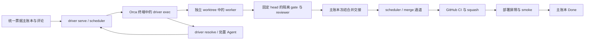

# CLAUDE.md

This file provides guidance to Claude Code (claude.ai/code) when working with code in this repository.

@AGENTS.md

## 常用开发命令

以下命令均从仓库根目录运行。Go 命令由根 `Makefile` 切换到 `driver/`；`PACKAGES` 使用相对该 Go module 的包路径。

| 命令 | 用途 |
| --- | --- |
| `make build` | 构建全部 driver 包，不安装或重启服务 |
| `make lint` | 运行 golangci-lint |
| `make vet` | 运行 Go 静态检查 |
| `make test` | 运行一次未缓存的完整 Go 测试，生成 JSON/JUnit 报告 |
| `make test PACKAGES=./internal/infra TEST_ARGS='-run TestRetryDefaultSleep'` | 聚焦已有单测 |
| `make race PACKAGES='./internal/executor ./internal/scheduler'` | 运行两个包的 race 检查 |
| `make vuln` | 运行 govulncheck |
| `make check` | 顺序执行 build、vet、lint、test、race、vuln，遇失败停止 |
| `make dev-tools` | 安装锁定的开发工具到 `.omc/tools/bin` |
| `bin/orca-factory check .` | 只读检查 core 安装副本、项目占位符和插件登记 |
| `bin/orca-factory selftest` | 在临时仓库运行安装、gate 回归、`issues.test.sh` 及 CLI 检查 |

命令定义见 [Makefile](Makefile) 和 [bin/orca-factory](bin/orca-factory)。工具、报告及定向检查的细节见 [driver/DEVELOPMENT.md](driver/DEVELOPMENT.md)。`make check` 不替代 project gate 的范围、契约和部署门禁。

## 高层架构

### 分发源与项目配置

本仓库既分发流水线，也使用流水线。`bin/orca-factory init` 把 `core/` 和项目模板安装到目标仓库的 `scripts/agent-gates/`；`update` 只刷新 core 文件，保留项目文件和 `local-*.md` 覆盖层。本仓库的 `scripts/agent-gates/` 同样是安装副本。

修改通用流水线时改 `core/`，随后运行 `bin/orca-factory update .` 同步，不直接改安装副本。项目差异放在 `agent-graph.env`、`gate.project.sh`、`COORDINATOR.project.md` 或覆盖层。接入或修改分发机制前读 [ONBOARD.md](ONBOARD.md)，尤其是“附：自接入”。

### 当前 Go 运行链路

- `driver/cmd/driver/serve.go` 组装常驻调度器并持有单实例锁。`internal/scheduler` 发现与认领票、恢复执行器、按仓库推进 FIFO 合并队列。driver 不依赖定时 coordinator；定时 coordinator 已退役，`install.sh` 不再安装它。已安装仓库中旧的 `agent-linear-scan` 定时任务必须关闭，否则 driver 拒绝认领。
- `internal/machine` 只计算状态转换和待执行效果，不做 I/O。`internal/executor` 执行单票派工、gate、review、correction 与 PR 交接；`internal/issues`、`github`、`feishu`、`orca` 和 `runx` 负责外部边界；共享票据类型在 `internal/task`。gate 验证已推送的固定 head，不使用 worker 的未提交内容。
- 合并事实来自配置选定的票据主账本评论中的 `merge-handoff-v1`、`merge-progress-v1` 和 GitHub 回读。交接冻结 head、基线、gate/review 证据与队列身份；本地执行器 checkpoint 用于派工恢复，不替代合并事实。缺失或冲突证据导致等待，不能据此重派或放行。部署与 smoke 确认通过后才写 Done、放行下一 PR。
- driver 把每张票的阶段同步到 Orca workspace 看板（列与映射见 `driver/README.md` 的“Orca 看板”，自定义列由 `bin/orca-factory board-columns` 安装）。看板与 `driver status` 展示观察数据，不是合并或恢复授权；状态快照可能过期。

修改外部输出解析、持久回执、派工恢复或合并通道前，读 [driver/CONTRACTS.md](driver/CONTRACTS.md)，使用 `driver/testdata/recorded/` 中的真实录制样本。排查服务、配额暂停或部署屏障时，读 [driver/README.md](driver/README.md)；部署约束仍以 `AGENTS.md` 指向的共享记忆为准。

修改 gate 或验证入口前，读 `core/gate.sh` 和 `scripts/agent-gates/gate.project.sh`。后者由 gate 从基线读取；`selftest` 和 `gate.test.sh` 只能作为票的 `CHECK`，不能嵌套放进重型 project gate，以免重入同一把锁。
