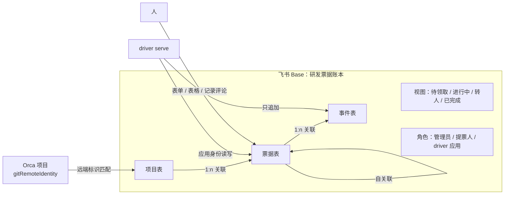
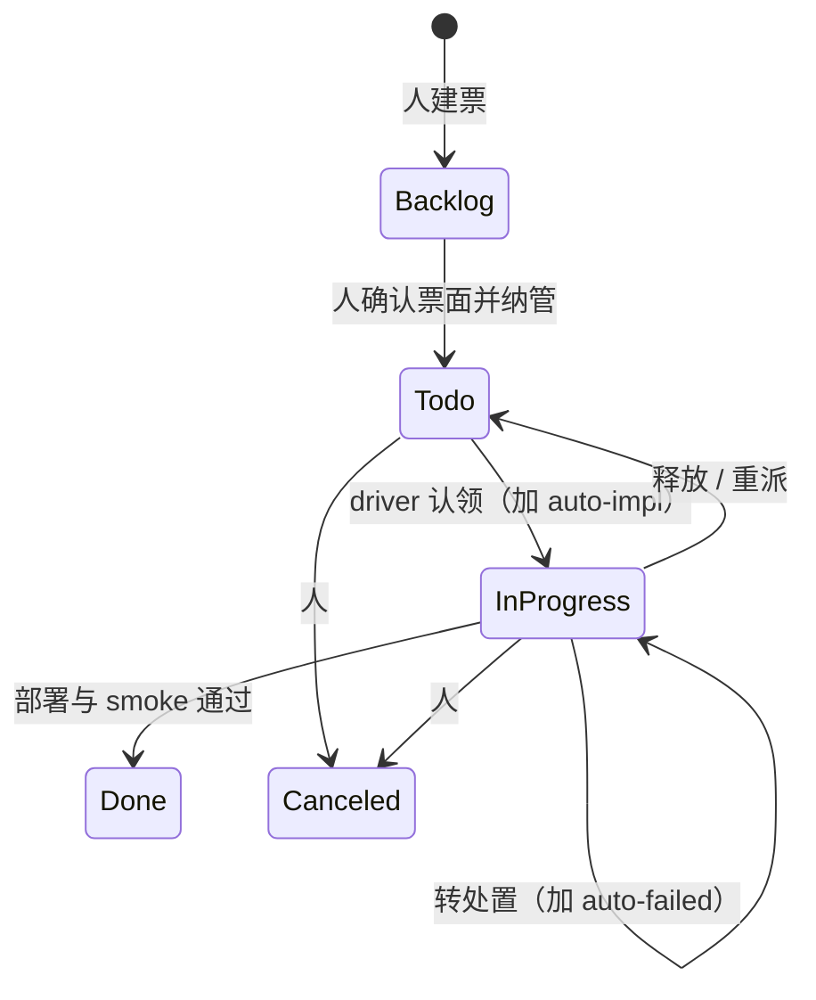

# 飞书多维表格票据账本

状态：草案，待评审。调研 2026-10-14，实测录制 2026-10-15。

## 1. 目标与非目标

**目标**：新增票据账本后端 `feishu`，用一个飞书多维表格（Base）承载多个项目的票、状态、依赖和 driver 证据。driver 的调度、合并通道和恢复逻辑不变，只换账本后端。

**非目标**：

- 不替换代码托管与合并通道。PR、CI、squash 仍走 CodeHost（当前是 GitHub）。
- 不改变 `merge-handoff-v1`、`merge-progress-v1` 等证据格式。
- 不做 Linear/GitHub 到飞书的历史迁移。迁移另立规格，沿用 `issue-tracker.md` 的 held import 流程。
- 本期不接审批卡片和事件订阅，只预留设计（第 10、11 节）。

## 2. 调研结论

来源：A = 飞书开放平台官方文档；C = 本机 `lark-cli 1.0.97` 的内置指南与 `--dry-run` 请求。

| 事项 | 结论 | 来源 |
| --- | --- | --- |
| 接口版本 | 存在两代接口。官方文档主线是 `bitable/v1`；lark-cli 使用 `base/v3`（`/open-apis/base/v3/bases/:base/tables/:table/records...`）。两者限额不同，见下行 | A、C |
| 单批写入上限 | `bitable/v1` batch_update 1000 条；`base/v3` 200 条 | A、C |
| 同表并发写 | 同一表并发写返回 `1254291`。必须串行 | A、C |
| 写后读 | Table 更新异步生效，写成功后立即读可能读到旧值 | C |
| 条件写入 | 没有版本号、ETag 或 If-Match，**不支持 CAS** | A |
| 记录历史 | `base/v3/bases/:base/record_history` 按记录返回版本号、操作人、时间、类型和字段前后值；每页最多 50 条。公式、查找引用和系统字段的变化不一定出现 | C |
| 记录评论 | `drive/v1/files/:base/new_comments` 支持锚定到记录（`block_id=table`、`base_record_id`、`base_view_id`）。官方旧评论文档不含 bitable | C（A 未覆盖） |
| 字段稳定性 | `field_id` 改名后不变；`record_id` 表内稳定唯一 | A、C |
| 只读字段 | 公式、查找引用、创建/修改时间、创建/修改人、自动编号只读；误写会被静默忽略并返回 `ignored_fields` | A、C |
| 查询 | 支持服务端筛选和排序；`base/v3` 单次最多 2000 条并带 `has_more`；`bitable/v1` search 单页最多 500 条 | A、C |
| 频控 | `bitable/v1`：查询类约 20 次/秒，batch_update 50 次/秒，建字段 10 次/秒。`base/v3` 未查到公开数值 | A |
| 容量 | 文本单元格 10 万字；关联最多 500 条；表行数按套餐 2000～5 万，可扩到 200 万 | A |
| 记录变更事件 | `drive.file.bitable_record_changed_v1`，需先订阅文件；payload 含 table_id、revision、operator，不含公式值。lark-cli 的 `event` 未提供此事件 | A、C |
| 长连接 | 官方 SDK（含 Go）支持 WebSocket 长连接收事件，不需要公网回调；商店应用不支持 | A |
| 卡片回调 | `card.action.trigger` 可走长连接，操作者在 `event.operator.open_id/user_id/union_id`；回调 token 30 分钟有效，最多更新 2 次 | A、C |
| 工作流 | `base/v3` 可创建、更新、启停工作流（lark-cli `+workflow-*`）；`bitable/v1` 只有列表 | A、C |
| 私有化域名 | lark-cli 只能选 `feishu` 或 `lark` 品牌，接口域名不可配置；官方文档未说明私有化域名 | A、C |

结论：多维表格能满足账本的读、写、关联、追加日志和审计需求。缺少 CAS 和写后读一致性，需要靠单写者、读回确认和修改时间补足（第 7 节）。

### 2.1 实测结果（2026-10-15，测试 Base，用户身份，`base/v3`）

样本在 `driver/testdata/recorded/feishu/`，已脱敏。下文 R = 实测。

| 编号 | 实测结论 | 样本 |
| --- | --- | --- |
| R1 | 记录列表 `GET .../records` 用 `offset`/`limit` 分页，响应按列组织：`fields`、`field_id_list`、`field_type_list`、`record_id_list`、`data`（行数组），另有 `has_more` 和表级修订号 `rev` | `tickets-list-filter-page1.json`、`page2` |
| R2 | 写入后立即 `batch_get` 读到旧值（`rev` 3，状态仍为 Todo）；稍后读到新值（`rev` 4） | `tickets-batch-get-after-write.json`、`tickets-batch-get-settled.json` |
| R3 | 6 个请求并发更新同一条记录：全部成功，没有出现 `1254291`；服务端按顺序应用，最后一次写入生效。写响应只有 `record_id_list`，不带 `rev` | `concurrent-update-1.json` |
| R4 | 记录历史每条带表级 `rev`、`activity_type`、`field_changes`（含 `field_type`，关联字段显示为 `SingleLink`，多选为 `MultiSelect`）。**操作人只给显示名，不给 ID**。历史有延迟：写后 3 秒读不到，约 60 秒内补全，6 次并发写最终各有一条 | `history-A-after-concurrent.json`、`history-A-after-concurrent-60s.json`、`history-event-tampered*.json` |
| R5 | 关联字段筛选可以一次传多个记录 ID（`intersects`），一次请求取回两张票的全部事件 | `events-list-multi-ticket.json` |
| R6 | 自动编号是字符串，如 `NO.001`；删除最大编号的记录后新建，编号继续递增（`NO.004`），不复用 | `tickets-get-D.json` |
| R7 | 写只读字段（自动编号）时，请求成功，响应 `ignored_fields` 带字段 ID 和原因 | `tickets-create.json` |
| R8 | 记录锚定评论可以创建，响应带 `idempotency_key`；但评论列表的条目**不带记录锚点**，无法从列表还原评论属于哪条记录 | `comment-create.json`、`comments-list.json` |
| R9 | 当前应用身份没有任何 `base:*` 权限，调用返回 `99991672` 和 `missing_scopes` | `bot-scope-denied.json` |

## 3. 总体结构

一个组织或团队建一个 Base。一个 Base 承载多个项目。

- **项目表**：把 Orca 项目映射到账本，并给出编号前缀。
- **票据表**：一行一张票。人和 driver 都写，但字段分工明确（第 4.2 节）。
- **事件表**：只追加的证据流，替代 GitHub/Linear 的评论。只有 driver 写。

## 4. 表结构

所有字段以 `field_id` 引用。字段名只用于展示，可以改名。

### 4.1 项目表

| 字段 | 类型 | 写入方 | 说明 |
| --- | --- | --- | --- |
| 名称 | 文本（主字段） | 人 | 展示名 |
| 仓库远端 | 文本 | 人 | 与 Orca `gitRemoteIdentity.canonicalKey` 相同，如 `github.com/vmxmy/orca-factory`。driver 用它匹配本机 Orca 项目 |
| 编号前缀 | 文本 | 人 | 如 `OF`，用于票号 `OF-12` |
| 启用 | 复选框 | 人 | 关闭后 driver 不领该项目的票 |

### 4.2 票据表

| 字段 | 类型 | 写入方 | 对应 `linear.Issue` |
| --- | --- | --- | --- |
| 标题 | 文本（主字段） | 人 | `Title` |
| 序号 | 自动编号 | 系统 | 与项目的编号前缀拼成 `Identifier` |
| 规范 ID | 文本 | driver（纳管时写一次） | `ID`。纳管时生成 UUID，之后不变 |
| 项目 | 单向关联 → 项目表，单选 | 人 | `Project` |
| 状态 | 单选：Backlog / Todo / In Progress / Done / Canceled / Duplicate | 人建票时；之后 driver | `State` |
| 标签 | 多选：`ready-for-agent`、`auto-impl`、`auto-failed` 等 | 人打 `ready-for-agent`；其余 driver | `Labels` |
| 要做 | 文本 | 人 | 票面「要做」 |
| CHECK | 文本 | 人 | 一条可执行命令 |
| SCOPE | 文本 | 人 | 真实路径 glob，每行一个 |
| 正文 | 文本 | 人 | intake 模板的其余小节 |
| 阻塞于 | 单向关联 → 票据表，多选 | 人 | `Relations`（blockers）。替代正文 `DEPENDENCIES` |
| 相关 | 单向关联 → 票据表，多选 | 人 | `Relations`（related） |
| 估算 | 数字 | 人 | 档位选择 |
| 优先级 | 单选 | 人 | `Priority` |
| 负责人 | 人员 | 人 | 人工跟进人，driver 不读 |
| 纳管指纹 | 文本 | driver | 纳管时对“要做、CHECK、SCOPE、阻塞于、相关”算的 sha256 |
| 阶段 | 单选 | driver | 镜像 driver 阶段，只供人看 |
| PR | 超链接 | driver | 镜像 |
| 合并 SHA | 文本 | driver | 镜像 |
| 创建时间 / 修改时间 / 修改人 | 系统字段 | 系统 | `CreatedAt` / `UpdatedAt` |

规则：

1. **纳管**等价于“规范 ID 非空并且纳管指纹非空”。原生未纳管的行可见但不领取，与 GitHub 后端一致。
2. **改了票面就要重新确认**：纳管后，人修改“要做、CHECK、SCOPE、阻塞于、相关”中任一字段，指纹就对不上。driver 把这张票视为 held，不领取，并在事件表写一条说明，直到人用 `driver issues adopt` 重新纳管。
3. **票面渲染**：适配器把结构化字段按 intake 模板拼成 canonical 正文，交给现有的纳管校验和 gate 读取。字段是唯一来源，正文不单独存一份 `DEPENDENCIES`。

### 4.3 事件表

| 字段 | 类型 | 写入方 | 对应 `linear.Comment` |
| --- | --- | --- | --- |
| 摘要 | 文本（主字段） | driver | 首行，如 `merge-progress-v1 merged` |
| 票据 | 单向关联 → 票据表，单选 | driver | 归属票 |
| 正文 | 文本 | driver | `Body`，与现在评论正文逐字节相同 |
| 来源 | 单选：driver / resolver / operator | driver | `Source` |
| 操作者 | 文本 | driver | operator 命令记录的操作者 |
| 创建时间 | 系统字段 | 系统 | `CreatedAt` |
| 修改时间 | 系统字段 | 系统 | `UpdatedAt`，用于篡改检测 |

规则：

1. 事件只追加，driver 从不更新或删除事件行。
2. 读取时比较“修改时间”和“创建时间”。两者不相等，说明有人改过这条事件，按“证据冲突”处理：停下等待，不推进合并，与现有契约一致。这个检查随列表一起返回，不需要额外请求。记录历史有约 60 秒延迟（R4），只用于给人看是谁改了什么。
3. 事件被删除时，列表里看不到它。合并通道遇到证据缺失本来就是等待，所以删除也会让流程停下，不会被放行。
4. 单条正文超过 10 万字时，沿用现有 v2 分片格式。
5. 人的讨论写在票据行的记录评论里。driver 不读记录评论，评论不构成指令或证据。评论列表本身也不带记录锚点（R8），无法可靠归属到票。

### 4.4 视图与角色

- **视图**：待领取（纳管、Todo、带 `ready-for-agent`、启用项目）、进行中、转人（带 `auto-failed` 或阶段为处置中）、已完成。视图只给人用，driver 不依赖视图的筛选。
- **高级权限角色**：
  - 管理员：全部可编辑。
  - 提票人：可新建和编辑票据行的人工字段；driver 字段只读；事件表只读。
  - driver 应用：作为 Base 协作者，拥有编辑权限。

角色是防误操作的措施，不是安全边界。真正的防线是第 4.2 节的指纹校验和第 4.3 节的历史校验。

## 5. 状态与标签

状态名和标签沿用现有后端，状态机不变。

`ready-for-agent`、`auto-impl`、`auto-failed` 的含义与 GitHub 后端相同。标签按选项名匹配，不使用 Linear 的标签 UUID。

## 6. 后端契约映射

driver 的账本接口只有四个方法，飞书后端逐一实现：

| 方法 | 飞书实现 |
| --- | --- |
| `Snapshot(projects, since)` | 读项目表（启用的项目）；票据表一次服务端筛选（项目属于启用项目）、按需分页；再读这些票的“阻塞于”“相关”对应记录的规范 ID 和状态。全部页都读完、并且各页的 `rev` 相同才返回；缺页、出错或 `rev` 不一致时整轮失败，不返回部分快照（见第 8 节） |
| `ListComments(id)` | 事件表按“票据”筛选，按创建时间升序；同时做第 4.3 节的修改时间校验 |
| `UpdateIssue(id, state, add, remove)` | 对票据行执行一次 batch_update，写状态和标签。标签按“读取当前值、合并修改、整体写回”处理 |
| `CreateComment(id, body)` | 事件表新增一行 |

`issues create`、`adopt`、`update`、`comment` 这几条 CLI 入口复用同一后端，只增加字段映射，命令语义不变。

## 7. 并发与一致性

### 7.1 写入串行

适配器为每张表维护一条进程内写队列，同一张表的写入串行发出。实测 6 路并发没有触发 `1254291`（R3），但官方文档和 lark-cli 都把它列为同表并发写的错误，所以仍然串行，并在遇到时按退避重试；超过重试上限就报错，不跳过。

### 7.2 认领

飞书没有 CAS，并发写是“最后写入生效”（R3），而且历史只给操作人显示名（R4），无法按 ID 区分 driver 和人。所以认领的正确性只靠现有的“单调度器”约束：同一账本只有一个 `driver serve` 写入，由单实例锁保证。步骤：

1. 重新读取票据行，确认它仍可领取（与现有认领前复核相同）。
2. 写入：状态改为 In Progress，标签加 `auto-impl`。
3. 读回这条记录，直到状态和标签都是本次写入的值，或者超时（默认 60 秒）。超时按“结果未知”处理，不派工，下一轮再对账。
4. 读回的值与本次写入不同，说明有人同时改了这张票：判定为归属冲突，不派工，写一条冲突事件，等人处理。

这一步只能发现读回窗口内的冲突，不能防止它发生。真正的防线是单实例锁，以及人工字段和 driver 字段的分工（第 4.2 节）。

### 7.3 写后读

- 写入后立即读可能读到旧值（R2），写响应也不带修订号（R3）。
- 写操作是否成功以写响应为准。需要确认最终值的步骤（认领、合并证据写入），用第 7.2 节的读回确认。
- 新写入的事件可能下一轮才可见。这不影响正确性，因为现有合并通道遇到证据缺失时本来就是等待。

## 8. 读取成本

一个 Base 承载全部项目，所以每轮发现的请求数与项目数基本无关：

| 每轮 | 请求数 |
| --- | --- |
| 项目表 | 1 |
| 票据表筛选 | ⌈候选票数 / 单页上限⌉，通常为 1 |
| 依赖票状态 | 1（按记录 ID 批量读取） |
| 在途票事件 | 1（按“票据”关联一次筛选全部在途票），再按需分页 |
| 在途票历史校验 | 每张在途票 1 次，只在出现新事件时执行 |

GitHub 后端的 100 票夹具每轮要 25 次请求；飞书后端在同样规模下预计 4～6 次，远低于频控。这个数字要在第 13 节的录制夹具上实测确认。

**分页一致性**：列表用 `offset` 分页（R1）。两页之间如果有记录新增或删除，后一页会错位，可能漏票或重复。每页响应都带表级 `rev`，所以规定：同一轮的所有页 `rev` 必须相同，否则整轮作废，下一轮重读。单页上限 2000 条，正常规模下只有一页，不会触发。

## 9. 身份、配置与凭据

- **身份**：driver 只用应用身份（tenant_access_token）读写，应用需要被加为 Base 协作者。人用自己的账号在飞书里操作。
- **应用权限**：当前应用没有任何 `base:*` 权限（R9）。上线前，由应用管理员在开发者后台申请并发布以下权限：`base:table:read`、`base:field:read`、`base:record:read`、`base:record:create`、`base:record:update`、`base:history:read`；第二期加记录评论和消息卡片相关权限。建表初始化可以用人的身份完成，不需要给应用 `base:app:create`。
- **项目配置**（仓库 `agent-graph.env`，属于项目规则）：
  - `AGENT_ISSUE_BACKEND=feishu`
  - `AGENT_FEISHU_BASE=<Base URL 或 base_token>`
- **机器配置**（不进仓库）：应用的 App ID 和 App Secret，以及可选的接口地址 `AGENT_FEISHU_ENDPOINT`（默认 `https://open.feishu.cn`）。凭据放在 driver 的 `EnvironmentFile` 或系统密钥库，不写进仓库或日志。
- **启动校验**：读取三张表的字段列表，校验必需字段的类型和选项都存在。缺字段、类型不符或缺选项时报配置错误，暂停该账本的领票，不猜测字段含义。
- **与 Orca 项目对接**：driver 按本机 Orca 项目的 `gitRemoteIdentity.canonicalKey` 去匹配项目表的“仓库远端”。只有两边都存在的项目才会被调度。

## 10. 人工入口（第二期）

- **建票**：Base 表单绑定票据表的人工字段。业务同事提交表单就是新建一行 Backlog 票，由研发补全 CHECK 和 SCOPE 后纳管。
- **审批**：lane 3 合并审批、“转人”决定发成飞书交互卡片，带批准和驳回按钮。卡片回调经长连接送到 driver。driver 校验操作者属于允许的审批人，然后按现有 operator 恢复命令的格式写入事件表。卡片只是入口，决定以事件表为准。
- **通知**：只推送转人、证据冲突、部署失败三类。

## 11. 事件订阅（第二期，可选）

订阅 `drive.file.bitable_record_changed_v1`，经长连接接收。事件只用来提前触发下一轮调度，不作为证据，也不跳过对账。长连接断开时回到轮询，行为不变。

## 12. 接口版本与私有化

- 适配器直接调用 HTTP OpenAPI，不依赖 lark-cli，以便在私有化部署中配置接口地址。lark-cli 只用于运维初始化、人工排查和录制样本。
- 优先使用 `base/v3`（支持记录历史、记录评论锚点、工作流写入）。启动时探测：`base/v3` 不可用时，如果 `bitable/v1` 能满足第 6 节的四个方法，就降级使用它；不能满足的能力（比如记录历史）要明确标为“不可用”，并在 `driver status` 中显示该限制。
- 国际版 Lark 使用相同的路径、不同的域名，通过 `AGENT_FEISHU_ENDPOINT` 切换。

## 13. 测试与验收

- **录制样本**：第一批已录制，见第 2.1 节和 `driver/testdata/recorded/feishu/`。实现时，每个样本在 `CONTRACTS.md` 登记并有对应测试。还需补录：应用身份下的同一组请求、`1254291`、记录历史翻页、多页列表之间 `rev` 变化。
- **一致性测试**：GitHub、Linear、飞书三个后端跑同一组契约测试，覆盖四个方法、缺页失败、依赖未完成、未纳管不领取、指纹不一致视为 held、事件被篡改时等待。
- **端到端验收**：
  1. 用测试 Base 和一个小仓库，建一张票并纳管。
  2. driver 领取、派工、gate、合并、smoke，票变成 Done。
  3. 事件表里的 `merge-handoff-v1` 和 `merge-progress-v1` 与 GitHub 后端的格式逐字节一致。
  4. 手动修改一条事件，确认合并通道停下等待。
  5. 纳管后手动修改 SCOPE，确认这张票不再被领取。

## 14. 分期交付

1. **账本接口整理**：确认四个方法足以表达全部后端，不改变现有行为。
2. **飞书后端第一期**：三张表、启动校验、四个方法、写入串行、认领的历史校验、录制样本与一致性测试、端到端验收。
3. **人工入口第二期**：表单建票、卡片审批、通知。
4. **事件加速第三期**：长连接订阅。

## 15. 待核实

| 编号 | 问题 | 状态 |
| --- | --- | --- |
| Q1 | `base/v3` 的频控数值 | 未核实。需要测试应用压测，或向飞书确认 |
| Q2 | `base/v3` 是否支持按关联字段一次筛选多条记录 | 已核实：支持（R5） |
| Q3 | 记录历史是否覆盖关联字段和多选字段的变化 | 已核实：覆盖，但有约 60 秒延迟（R4） |
| Q4 | 高级权限开启后，应用身份的查询结果是否被行列权限过滤 | 未核实。应用权限开通后，在测试 Base 开启高级权限再录制 |
| Q5 | 私有化部署版本是否提供 `base/v3`，以及接口域名的形式 | 未核实。需要向目标客户或飞书私有化团队确认 |
| Q6 | 自动编号是否可能在删除后复用 | 已核实：不复用（R6） |
| Q7 | 同表并发写在什么条件下返回 `1254291` | 未复现：6 路并发都成功（R3）。实现时保持串行 |
