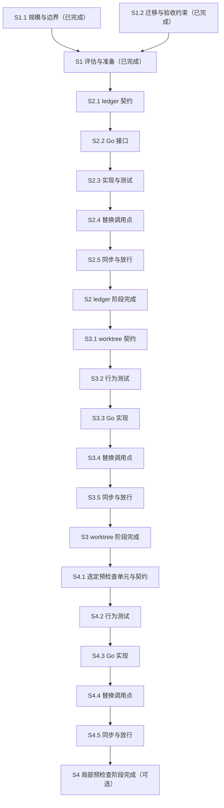

# Shell 组件收敛到 Driver

基线：2026-10-08，基于 `/home/laoxu/github/orca-factory` 的评估结果。把 `core/` 下自包含的 shell 组件逐个迁移到 Go driver，冻结既有契约，同步核对安装副本，不破坏客户仓库。本 spec 定义迁移范围、放行条件与任务依赖，并记录实施状态。用户已授权按 spec 实施，当前跳过 Linear 建票。

## 当前缺口

- `driver/` 已是 Go 后端，约 3.2 万行，其中测试约 1.7 万行；runtime 仅依赖 `BurntSushi/toml`。迁移复用现有包与边界，不借机增加运行时依赖。
- `core/` 约 1.9k 行，包含 `gate.sh`（211 行）、`linear-precheck.sh`（731 行）、`prune-run-worktrees.sh`（358 行）、`ledger.sh` 与 `install.sh`。行数是评估时的规模，不作为验收指标。
- 候选组件依次为 `ledger.sh`、`prune-run-worktrees.sh`、`linear-precheck.sh` 中明确自包含的预检查逻辑。迁移前仍须逐项确认调用者、契约边界与持久化格式，不能仅凭文件名推断可替换。
- 代码交付包括源实现、受版本管理的开发安装副本及隔离候选 driver 验收；生产 driver 与客户安装在合并后配套发布。仅新增 Go 包不代表代码交付完成，代码合并也不代表客户发布完成。

## 实施与约束

1. 每次只迁移一个组件或一个明确自包含的预检查单元。先列出 CLI 参数、环境变量、工作目录、stdout/stderr、退出码、锁与并发语义、调用者、持久化路径及格式，再冻结契约。接口设计不得改变既有调用者可观察行为。
2. 复用现有 driver 实现，按需落入 `driver/internal/ledger`、`driver/internal/worktree` 或 `driver/internal/linear`。包路径是目标归属，不授权重构无关代码或迁移整个 shell 文件。
3. 同步替换调用点与 `core/` 分发内容。通过现有 `bin/orca-factory init/update` 原子替换受管理安装副本，不手工逐个覆盖客户仓库文件。切换前核对 driver 可用性与版本配套，失败保留原可用安装，不能留下新调用点与旧实现混用的状态。
4. 每次切换列出全部已安装副本、源版本、安装版本和核对结果。安装清单须完整，不能用抽样代替全部核对。发现 `DIFFERS`、`OVERRIDDEN` 或客户自定义内容时停止该副本切换，先确认归属与保留方式，不强制覆盖或把差异当作迁移成功。
5. 保留客户仓库的配置、自定义入口、在途执行器与持久状态。账本、数据库、checkpoint 的路径与已交付格式保持可读写；不得删除、清空或重建状态，不重置历史预算，不以迁移绕过配额暂停。
6. 保留冻结 head、Linear 评论证据与配额暂停的恢复语义。缺失、冲突或不完整证据仍阻止推进，不因 Go 替换而授权重复派工、重放写操作或解除保护。
7. 保留 `driver/CONTRACTS.md` 与 `driver/testdata/recorded/` 的真实样本。契约有新发现时补充说明及脱敏实录；合成行为测试不能冒充实录，不能删除样本或降低 `TestRecorded*` 门禁来使迁移通过。
8. 迁移实施遵循 `docs/agents/MEMORY.md` 与 `driver/DEVELOPMENT.md`。先运行已有相关测试；覆盖不足时先写行为断言并确认失败，再实现。通过根 Make 入口运行相关测试与 race 检查，保留失败退出和报告；涉及恢复、取消或并发退出时保留 executor、scheduler 的 goleak 整包门禁。

不改 `core/gate.sh`、已安装的 `gate.sh` 或客户 `gate.project.sh`；嵌套锁与客户自定义入口保持原样。不迁移 `mods/swarm-board`（TS 插件），不改变 `AGENT_SMOKE_CMD` 的 bash 命令边界。`core/install.sh` 不属于本轮迁移候选。

2026-10-08 批准的 S2 计划允许 `bin/orca-factory init/update` 增加 ledger 专属 driver 契约预检、原版/当前版识别及同目录原子入口替换。原子性只覆盖 ledger，不重构整个分发系统、不承诺整批回滚。S3 随后获准仅将同样的组件契约预检、原版/当前版识别、0755 和同目录 rename 扩展到 prune 入口；不将分发机制全局平台化。后续组件若无法满足切换条件仍须停止并记录阻塞。客户自定义文件与任何持久状态不属于清理范围。

S2 的 Go 入口实际接管命令分派、发现/创建/追加/查询、重试、计数和 Orca 进程管理；保留已安装 jq 执行 JSON/统计表达式，以保持任意 JSON、jq JSON 排序和错误类型/部分输出契约。此实现不执行旧 ledger.sh、不内嵌 bash，不新增 Go 或系统依赖；它不是纯 Go，也没有移除 jq、Orca、date 和 sleep。原 `driver ledger` 与共享 runx 语义不变。

## 放行证据

- 每个组件有冻结契约清单：边界、全部调用者、输入输出、失败行为、并发约束、持久化路径与格式。新旧实现对同一输入产生等价可观察结果，已有持久记录无需重写即可继续使用。
- 相关公开调用路径的行为测试通过。冻结 head 不被当前 head 替代；恢复仍读取并核对 Linear 评论证据；配额暂停跨取消或重启保持，只有既有恢复条件满足才继续。使用已有录制夹具与 goleak 门禁，不仅验证私有 helper。
- `ledger.sh` 迁移证明已有账本的读写、追加、错误处理及并发语义不变，没有丢失记录、重复写入或预算重置。具体字段和格式以契约子票读取的当前实现为准。
- `prune-run-worktrees.sh` 迁移证明候选筛选、保留条件、路径处理、失败与退出码不变。只在隔离临时 Git 仓库验证清理；活跃、未知或证据不足的 worktree 不得被误删，不用客户工作树做破坏性验收。
- `linear-precheck.sh` 迁移证明选定预检查单元的读取、判断、输出及失败分类不变，保留 shell 调用边界、评论证据与预算控制。未选中的逻辑保持原样，不以局部迁移宣称全文件已收敛。
- 代码放行要求源 `core/` 与受版本管理的开发安装副本一致，并以显式隔离候选 driver 完成安装验收；开发仓库 `bin/orca-factory check` 不得报告 `DIFFERS` 或 `OVERRIDDEN`。客户部署不是代码合并前置条件。发布放行另要求全部目标副本配套切换、逐目标运行 `check`，并核对客户入口和持久状态；不可达或未更新目标保留为发布待办，不能宣称全客户迁移完成。
- 安装验证覆盖已有仓库的 `update`、隔离新仓库的 `init` 及原子替换失败路径。更新失败保留原可用版本；回退使用保留的旧程序与分发内容，不回退、删除或重置持久状态。
- 后续实施按变更运行要求的 Make 检查、项目 gate 与 CI。`make check` 不替代契约、固定基线、scope 或安装副本核对。记录实际命令、退出结果与报告路径后才关闭迁移阶段。

以上是实施验收要求，不代表已经执行或通过。实际证据与阻塞见文末。

## 工作顺序

每个阶段创建一张父票，每个子任务创建一张子票。父子关系表示范围，`blocks` 关系表示实施顺序；两者不能互相替代。下列编号是建票占位标识，不是已存在的 ZII 票号。

### 阶段 1：评估与准备（已完成）

父票 `S1`：记录候选范围、保留边界和评估结论，状态标为已完成。

- 子票 `S1.1`：记录现有规模、迁移候选与不可迁移边界，已完成。
- 子票 `S1.2`：记录契约冻结、安装副本核对和恢复验收要求，已完成。

本阶段完成只表示评估与规范就绪，不表示各组件的契约盘点、Go 实现或客户安装已完成。父票依赖两张子票完成。

### 阶段 2：`ledger.sh` → `driver/internal/ledger`

父票 `S2`：迁移最小自包含候选 `ledger.sh`，全部子票通过后放行。

| 子票 | 范围与完成条件 | 被谁阻塞 |
| --- | --- | --- |
| `S2.1` 当前契约 | 读取当前 `ledger.sh`，列全调用者、账本路径与格式、读写及并发语义，冻结行为 | `S1` |
| `S2.2` Go 接口 | 基于冻结契约设计最小 Go 接口及既有调用边界，不增加存储格式或迁移机制 | `S2.1` |
| `S2.3` 实现与测试 | 复用已有测试，必要断言先红后绿；实现既有账本行为，覆盖历史记录和关键失败路径 | `S2.2` |
| `S2.4` 替换调用点 | 替换全部已识别调用者，保留外部调用契约与恢复语义，完成公开路径测试 | `S2.3` |
| `S2.5` 同步与放行 | 同步 `core/` 分发内容，以 `init/update` 原子切换全部安装副本，完成 `check`、状态保留及回退核对 | `S2.4` |

`S2.4` 与 `S2.5` 可分票准备，但须组成同一次配套切换；不得单独发布未同步的调用点或分发内容。

### 阶段 3：`prune-run-worktrees.sh` → `driver/internal/worktree`

父票 `S3`：迁移 worktree 清理组件，复用阶段 2 已证明的安装切换流程。

| 子票 | 范围与完成条件 | 被谁阻塞 |
| --- | --- | --- |
| `S3.1` 当前契约 | 冻结调用者、候选与保留规则、Git/Orca 边界、路径处理、失败退出及持久状态关联 | `S2` |
| `S3.2` 行为测试 | 运行已有覆盖；不足时在隔离临时 Git 仓库增加最小行为断言并确认迁移断言失败 | `S3.1` |
| `S3.3` Go 实现 | 在 `driver/internal/worktree` 复用现有能力，使冻结行为测试通过，不扩大清理范围 | `S3.2` |
| `S3.4` 替换调用点 | 替换全部已识别调用者，验证实际公开调用路径，不触碰客户工作树 | `S3.3` |
| `S3.5` 同步与放行 | 同步 `core/` 与全部安装副本，完成原子切换、`check`、客户入口与状态保留核对 | `S3.4` |

测试子票在实现前锁定断言；最终通过结果由实现与放行子票记录。`S3.4` 与 `S3.5` 同一次配套切换，不分开发布。

### 阶段 4：`linear-precheck.sh` 部分逻辑 → `driver/internal/linear`（可选）

父票 `S4`：按实际需求迁移明确自包含的预检查逻辑，不要求全文件迁移。

| 子票 | 范围与完成条件 | 被谁阻塞 |
| --- | --- | --- |
| `S4.1` 选择与契约 | 说明具体需求，划定一个自包含单元，冻结调用者、API/评论契约、输出及预算边界；无合适单元则记录不实施决定 | `S3` |
| `S4.2` 行为测试 | 对选定单元复用真实录制夹具，必要行为断言先确认失败，保留失败分类与恢复门禁 | `S4.1` |
| `S4.3` Go 实现 | 复用 `driver/internal/linear`，使选定单元测试通过，不改变未迁移逻辑或配额保护 | `S4.2` |
| `S4.4` 替换调用点 | 仅替换选定单元调用，保留剩余 shell 入口及输出契约，验证公开路径 | `S4.3` |
| `S4.5` 同步与放行 | 同步 `core/` 与全部安装副本，完成原子切换、`check`、恢复及状态保留核对 | `S4.4` |

`S4.1` 明确实施范围后才启动后续子票。若决定不实施，记录理由并取消未启动子票，不以取消表示迁移完成。`S4.4` 与 `S4.5` 同一次配套切换。

### 建票依赖图

箭头表示前项阻塞后项。每张阶段父票还须被本阶段全部子票阻塞，不只依赖图中最后一张子票；下一阶段首张子票由上一阶段父票阻塞。不得把父票设为阻塞自己的子票，以免形成依赖环。

## 跟踪与当前结论

- 阶段 1 与 `S2.1`–`S2.5` 已完成。S2 PR #198 已通过 gate、审查修复和 CI，合并为 `7b4df2c566a6f4977bb6cbf4609fed6a57ea10ba`；正式 driver 已在本机部署启动且健康。原两个 S2 worktree 已归档清理。下方 S2 本地证据是当时记录，不代表当前仍待审查或本机部署。其他客户部署清单仍是发布待办，不是代码合并前置条件。S3 本地实施结果见文末；S4 未启动。
- 用户已选择跳过 Linear 票据，使用本文 `S1`–`S4` 本地任务图跟踪；没有创建本次迁移票，不使用旧任务票号代替。
- `S2.1` 证据见 [ledger 契约](ledger-contract.md)：11 个可执行调用位置，另有 8 个文档命令位置；已有隔离账本自测片段退出 0，未访问真实 Linear。账本在 Linear 评论中，追加无锁或写前去重，失败可能已有远端副作用。
- 原安装阻塞已由批准的 ledger 单组件范围修订解除。`bin/orca-factory` 先探测 `ledger-shell-v1` 并识别入口，再暂存、设置权限、检查语法及 rename；缺失/不兼容 driver、自定义入口、符号链接或替换失败均阻止 core 写入。其他 core 文件不承诺原子性。
- 既有 `driver ledger` 保持原样。独立 `driver ledger-shell` 使用 `ledger.RunShell`，不读取 driver 配置；`--contract-version` 不要求 team/project，不访问网络。`core/ledger.sh` 仅检查环境、探测契约和 exec，所有已识别调用者的命令无需改变。
- 全部客户安装副本清单尚未建立。源代理报告的唯一非临时切换目标为 `/home/laoxu/github/orca-factory/.claude/worktrees/agent-af11a2a8b843fb453`：原入口基线 `76a944f`，新入口 `ledger-shell-v1`，由 `AGENT_DRIVER_BIN=<worktree>/.omc/s2/orca-factory-driver bin/orca-factory update .` 同步，`bin/orca-factory check .` 退出 0，无 `DIFFERS/OVERRIDDEN`。这是源 worktree 的显式二进制安装验收，不证明日常 PATH 入口或客户环境已可用。目标环境、project 文件和运行状态未改。
- 开发集成与发布边界（2026-10-08）：`/home/laoxu/github/orca-factory` 位于 `feature/shell-to-driver-convergence`，两边 HEAD 均为 `76a944f`。开发分支允许用隔离候选 driver 同步、验收受版本管理的安装副本；正式 driver 在合并后更新。此前把日常旧 driver 视为开发安装阻塞的结论已纠正。日常 PATH 的 `/home/laoxu/.local/bin/orca-factory-driver` 尚不支持 `ledger-shell-v1`（探测退出 2），该事实保留为发布待办，不阻止代码交付。
- 主工作区同步前再次确认仅 ledger 有差异，其余 18 个 core 副本一致。当前 driver 源文件与已通过测试的源 worktree 字节一致，复用其二进制到隔离路径 `/tmp/claude-1000/-home-laoxu-github-orca-factory/79717a69-f186-41dc-9e91-0049c99bec51/scratchpad/s2-integration-driver`，契约探测输出 `ledger-shell-v1`。以显式 `AGENT_DRIVER_BIN` 执行 `bin/orca-factory update .`，退出 0，结果 `changed=1 added=0 unchanged=18`。仅 ledger 副本内容改变；project 文件、其他改动及正式 driver 字节未变，没有重启服务。
- `/home/laoxu/github/orca-factory/core/ledger.sh` 与 `/home/laoxu/github/orca-factory/scripts/agent-gates/ledger.sh` 现均为薄入口 blob `2c64501f4427c07f115f4990e7b2d50b9ab15925`。正式使用前仍需发布配套 driver；其他客户仓库未扫描或切换。客户部署不属于代码合并前置条件，发布阶段须建立目标清单并逐目标检查配套程序、入口及状态保留。
- 源 worktree 本地检查：先运行已有 `make test PACKAGES='./internal/ledger ./cmd/driver'`，85 tests，退出 0。新增 CLI 和安装断言分别先失败（make 退出 2），后通过。最终同一聚焦 test/race 均 88 tests、退出 0；`make build`、`make vet`、`make lint` 退出 0（lint 0 issues）。首次 lint 为 6 个 errcheck 输出写入结果问题，make 退出 2；修正后成功，未隐藏首次失败。完整 `bin/orca-factory selftest` 首次退出 0，包括 gate 回归及插件 validate/test；未运行真实服务或部署。
- 报告位于该 worktree 的 `.omc/reports/test/{tests.json,junit.xml}`、`.omc/reports/race/{tests.json,junit.xml}`、`.omc/reports/s2-red/`、`.omc/reports/s2-install-red/`、`.omc/s2/lint-red.log` 和 `.omc/s2/selftest.log`。开始及交付前的 integration tip 均为 `76a944f`，无需 merge commit。未提交、push、清理 worktree 或推进 S3。
- 主工作区集成检查：`git diff --check`、修改入口的 `bash -n`、源码与安装副本的 `cmp` 通过。显式候选 driver 的 `update`、`check` 及公开安装入口 `ledger.sh --contract-version` 均退出 0，19 个 core 副本及插件登记正常，开发分支 `DIFFERS` 已消除。没有重跑源代理已完成的 test/race/build/vet/lint/selftest；完整 project gate、审查与远端 CI 仍由后续交付流程处理，未宣称它们已通过。
- 代码合并证据须包含契约、行为测试、调用点与分发源码、开发安装副本 `check`，并满足后续 gate、审查与 CI。正式程序更新及完整客户安装清单在发布阶段记录；客户自定义冲突、不可达副本或不兼容程序阻塞该目标发布，不作为代码合并前置条件。
- 收敛范围不包含嵌套锁 gate、ledger/prune 组件专属切换以外的分发工具、TS 插件和 bash smoke 边界。迁移完成不以 shell 行数归零衡量，而以候选组件职责进入 driver、既有契约保持、客户安装一致且历史状态保留衡量。

## S3 本地实施证据（2026-10-08）

- `S3.1`–`S3.5` 本地代码、行为与开发安装验收完成。工作树 `/home/laoxu/github/orca-factory/.claude/worktrees/agent-a94443130127c3073`，工作分支 `worktree-agent-a94443130127c3073`，基线为 S2 合并提交 `7b4df2c`。集成分支 `feature/prune-worktrees-to-driver` 当前 tip 同为该基线。
- 契约见 [Worktree 清理契约](prune-worktrees-contract.md)，包括 `core/install.sh` 的 Git show 管道入口。无需修改 `core/install.sh`、coordinator、precheck 或 agent-graph 调用命令。薄入口无脚本目录依赖，委派 `driver prune-worktrees`；流程进入 `driver/internal/worktree`，不内嵌 bash，不调用旧业务。旧脚本仅以带来源 SHA/blob/hash 的测试夹具保留。
- 明确安全差异：旧 legacy run 用年龄/finished 直接 force 删除脏目录。按 S3 安全验收，补主检出/物理路径排除、已知 Git 归属、locked 保留和 clean 门禁；关联票仍用既有非 started 判定。未知路径、读取失败或缺票证据保留。不宣称全行为无差异。预算仍只约束补偿阶段，install 的 70 秒 alarm 不变。取消结束子进程组并回收，保留信号退出码。
- 已有相关测试先运行：`make test PACKAGES=./cmd/driver`，51 tests，退出 0；原已有 prune selftest 片段在本地临时 Git/bare origin 与 fake 服务下退出 0。公开入口断言先红：原脚本对 probe 参数仍尝试删除脏 legacy，打印 `ok=false` 并退出 7；make 退出 2。安装断言先红：旧分发接受自定义 prune，make 退出 2。两者随后转绿，没有隐藏失败。
- 最终 `make test PACKAGES='./internal/worktree ./cmd/driver'` 与同范围 `make race` 均为 53 tests，退出 0。公开测试覆盖管道启动、中文空格路径、dirty legacy 保留、清理失败和取消子进程回收；既有 selftest 覆盖候选筛选、票状态、Git/Orca/PR 失败、快照、预算与数量上限。未修改 executor/scheduler 生命周期，没有增加 verifier 或新的测试框架。
- `make build`、`make vet`、`make lint` 均退出 0，lint 为 0 issues。一次完整 `AGENT_DRIVER_BIN=<工作树>/.omc/s3/orca-factory-driver bin/orca-factory selftest` 退出 0，含 gate regression、插件 validate/test 和 fake 服务验证。之后只重跑相关 Go 检查与已有 prune 片段，不嵌套 gate。
- `init/update` 在写 core 前检查 ledger/prune 两契约及入口归属。prune 增加同目录 0755 rename；安装测试覆盖原版 update、全新 init、当前版 update、自定义入口、符号链接、不兼容 driver 与 rename 失败。原子性仍只保证各组件入口，不保证整批回滚。
- 唯一非临时开发切换目标为本 S3 工作树，显式候选程序位于 `.omc/s3/orca-factory-driver`。`update .` 为 `changed=1 added=0 unchanged=18`；再次 update 为 `changed=0 added=0 unchanged=19`。`check .` 退出 0，19 个 core 副本与插件登记一致，无 DIFFERS/OVERRIDDEN。项目文件与正式程序未改，没有部署、重启、真实 Linear 写入或客户 prune。客户目标清单/配套发布在合并后推进，不是代码合并前置。
- 证据目录为本工作树 `.omc/s3/`：`existing.log`、`existing-prune.log`、`public-red.log`、`public-green.log`、`install-red.log`、`test.log`、`race.log`、`build.log`、`vet.log`、`lint.log`、`selftest.log`、`update.log`、`check-final.log`。机器报告为 `.omc/reports/{test,race}/{tests.json,junit.xml}`；红报告另存 `.omc/reports/s3-public-red/` 与 `.omc/reports/s3-install-red/`。
- 未删除任何受版本管理路径；旧生产业务已被薄入口替换。尚待主线程集成、PR/gate、已请求的双轴审查、CI、合并和正式发布。未 push，S4 未启动。
