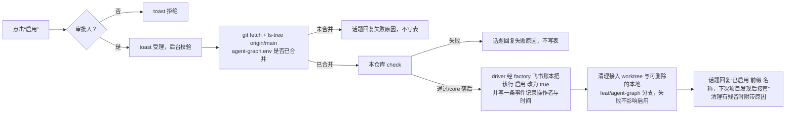

# orca-factory driver

这是用于取代 LLM coordinator 的 Go 驱动器，包含调度器、单票执行器、合并通道、部署屏障、用量账本和处置 Agent；整体演进计划见地图 [ZII-826](https://linear.app/ziikoo/issue/ZII-826)。

调度器推进已验证的队首 PR：head 落后 main 时先对固定 head/main 的合并结果跑完整 gate，未落后时直接以 head CI 为准；GitHub 回读确认 squash 后按该 SHA 验证部署及 smoke，全部通过才写回 Done、放行下一 PR。合并通道自己保证合并结果基于最新 main，因此 main 的分支保护不得开启“合并前须与 main 同步”（`required_status_checks.strict`），否则落后的 PR 永远不会变成 `clean`。交接、合并 intent 和部署进度存在配置选定的票据主账本评论，重启按冻结身份恢复；缺验证证据或 CI 未明确成功继续等待，lane 2 未自动合并、命中 `AGENT_LANE2_MANUAL_GLOBS` 或 `AGENT_LANE3_GLOBS` 则转处置 Agent 复核或直接转人工并移出队列（详见下文）。合并结果 gate/correction 的 #142 接点与持久格式见 `CONTRACTS.md`。

`driver serve --dry-run` 不合并、不写回、不 fetch；scope 使用已读取的声明。旧票检查若需要 fetch 会打印省略原因并报告等待，不据此推断可以释放或重派。

## GitHub Issues 主账本

项目配置必须显式设置 `AGENT_ISSUE_BACKEND=github`（配 `AGENT_GH_REPO=owner/repo`）或 `feishu`。空值或 `linear` 直接报错，不静默选择默认后端；无双写或自动 fallback。

`driver issues snapshot/read/create/adopt/update/comment` 是统一 GitHub CLI。原生未纳管票可见但不领取；adopt 校验「要做」、CHECK、SCOPE 和正文 `DEPENDENCIES` 的完整 canonical ID 数组。旧 UUID/ZII 与 checkpoint/receipts 身份不变，GitHub repo/number/URL 独立。发现缓存与历史来源时间不授权关键动作；认领、恢复、resolver、proposal、squash 和 smoke 都使用完整 fresh 证据。

关闭或 ImportHold 禁止新执行/合并，历史部署屏障仍在 FIFO 中观察对账。auto-failed 不普通重试。任务 PR 引用 Issue URL，不用 Closes/Fixes 提前关闭票。看板与 status 只展示 GitHub request 额度。

迁移及生产切换见 [票据主账本](../docs/agents/issue-tracker.md)。`driver maintenance drain|freeze|resume|status` 保存本机维护状态；drain 禁新派工，freeze 需本机合作 sessions/writes 空闲并阻外部写入。这不证明远端写者已退出。真实导出、held import、release-hold 和配置切换分别授权，不因为部署二进制就切 backend。`driver issues backend` 只读输出当前进程选定的后端与 `AGENT_GH_REPO`。

GitHub 配额保护读取 rate-limit 响应头：低额度暂停调度，reset 或无 reset 的退避期限后允许下一次发现刷新；403 权限错误不伪装成 quota。

## 飞书账本后端

飞书后端把票据账本放在一个飞书多维表格（Base）中。代码托管、PR 与合并通道仍走 GitHub。设计与字段定义见 [飞书多维表格票据账本](../docs/specs/feishu-bitable-ledger.md)。

### 初始化 Base

1. 新建一个 Base。用人的身份建表即可，可以用 `lark-cli`，应用不需要 `base:app:create`。
2. 建三张表：`项目`、`票据`、`事件`。字段名、类型和选项以规格第 4 节为准；driver 实际校验的清单在 `internal/issues/feishu.go` 的 `feishuTables`。
3. 在 `项目` 表加一行：`仓库远端` 填 `AGENT_FEISHU_PROJECT` 的值（如 `github.com/vmxmy/orca-factory`），填写 `编号前缀`，勾选 `启用`。

### 应用权限与协作者

1. 应用管理员在开发者后台为应用申请并发布规格第 9 节列出的 `base:*` 权限。
2. 把应用以 **edit** 权限加为该 Base 的协作者。只授予 scope 不够：未加协作者时读取成功，写入返回 `91403`，读记录历史返回 `code 1`。
3. Base 开启高级权限时，不要给应用分配受限角色。未分配角色的协作者应用读写全部行与字段（规格 Q4）。

### 配置

| 位置 | 配置项 | 说明 |
| --- | --- | --- |
| 仓库 `agent-graph.env` | `AGENT_ISSUE_BACKEND=feishu` | 选飞书后端 |
| 仓库 `agent-graph.env` | `AGENT_FEISHU_BASE` | Base URL（含 `/base/<token>`）或 base token |
| 仓库 `agent-graph.env` | `AGENT_FEISHU_PROJECT` | 本仓库在 `项目` 表的 `仓库远端` |
| 仓库 `agent-graph.env` | `AGENT_GH_REPO` | 仍用于代码托管、PR 与合并 |
| 机器 `driver.env`（服务的 `EnvironmentFile`） | `AGENT_FEISHU_APP_ID`、`AGENT_FEISHU_APP_SECRET` | 应用凭据。不进仓库，不写日志 |
| 机器 `driver.env` | `AGENT_FEISHU_ENDPOINT` | 可选。默认 `https://open.feishu.cn`；Lark 或私有化部署时改 |

启动时 driver 读取三张表的字段并校验。缺字段、类型不符或缺选项时启动失败，不领票。

### 可选群通知

1. 在应用开发者后台启用机器人能力，申请并发布 `im:message:send_as_bot` 权限，参见[发送消息接口](https://open.feishu.cn/document/uAjLw4CM/ukTMukTMukTM/reference/im-v1/message/create)。
2. 建立接收异常通知的飞书群，在群设置中添加该应用机器人。取得此群的 `chat_id`（`oc_...`），不要使用群名称、邀请链接或用户 ID。
3. 在机器 `~/.config/orca-factory/driver.env` 设置 `AGENT_FEISHU_NOTIFY_CHAT=oc_...`，复用已有应用凭据。单个仓库可在 `agent-graph.env` 设置同名值覆盖机器默认，设置空值可关闭该仓库通知。进程环境覆盖机器文件；仓库配置优先。`AGENT_FEISHU_BASE` 使用完整 Base URL，使消息带可点击的记录链接。
4. 按现有服务管理流程重新加载配置。此次功能提交不自动建群、加机器人、发测试消息或切换生产配置。

调度器观察到转人（含处置 Agent）、证据冲突或部署失败时发送票号、标题、类别、原因摘要及记录链接。未配置群时保持原行为。每个票据的同类别、同原因只尝试发送一次，发送前在事件表写去重标记；发送失败也保留标记，重启不会补发。事件读写失败不发送，下轮重新检查。消息发送失败只记 warn，不阻断调度。

暂停期间不通知。通知使用本轮快照已读取的评论判断原因和去重，不额外读取事件。快照因票级归属或处置凭证的证据冲突失败时，仍通知本轮已完整读取评论的异常票和其他待通知票，整轮快照继续报错并停止调度。合并证据冲突也会通知，包括没有执行归属的纳管票；底层事件读取失败时不绕过证据校验发送通知。

日志中的 `230001` 表示请求参数无效，应核对 chat_id；`230002` 表示机器人不在群内；`99991672` 表示缺少权限，应按错误列出的 scope 申请并发布。修复配置不会重发已有标记的通知。`serve --dry-run` 不发通知。

### 真实环境测试

`TestFeishuLive` 以应用身份在测试 Base 上跑一遍：建票并纳管、快照可领取、认领读回、写事件并逐字节读回、直接改 SCOPE 后票变为 held、直接改事件后读取报证据冲突，测试结束先删除本次创建的事件，再删除票；事件未完整发现或删除失败时报告错误并保留票，避免留下失去关联票的事件。

```sh
cd driver
set -a; . <机器 driver.env>; set +a
AGENT_FEISHU_LIVE=1 AGENT_FEISHU_BASE=<测试 Base> AGENT_FEISHU_PROJECT=<仓库远端> \
  go test ./internal/issues -run TestFeishuLive -count=1 -v
```

凭据只经环境变量传入，不写进命令行或日志。未设置 `AGENT_FEISHU_LIVE=1` 或缺任一变量时测试跳过。只对测试 Base 运行。

### 排查

| 现象 | 原因与处理 |
| --- | --- |
| `feishu API code 91403` | 应用未加为 Base 协作者，或权限低于 edit。按“应用权限与协作者”第 2 步添加。该错误不重试 |
| `feishu API code 99991672: missing scopes ...` | 应用缺 scope。按错误列出的 scope 申请并发布。该错误按全局故障处理，不重试 |
| `feishu table <表> schema mismatch: ...` | 字段缺失、类型不符或缺选项。按错误逐项修正 Base，再重启 driver |
| `feishu table <表> missing or duplicated` | 表名不是 `项目`、`票据`、`事件`，或有重名表 |
| `feishu ignored fields ...` | 写入了只读字段，说明字段类型被改过。核对表结构 |
| `feishu read-back not settled ...`、`write not confirmed` | 写入结果未知。飞书写后读有延迟，driver 不派工，下一轮再对账。持续出现时检查网络和飞书服务状态 |
| `feishu event ... evidence conflict` | 事件被人改过或关联到多张票。合并通道停下等待，需人工核对记录历史 |

## 内置定时协调与恢复

`driver serve` 持有单实例锁并持续执行调度循环，负责发现、认领、执行器恢复和合并推进。它不需要 Orca Automation 定时启动协调 Agent；同仓库的旧 `agent-linear-scan` 必须保持关闭，开启或无法核实其状态都会阻止驱动器认领，避免两个协调者竞争。

排查停止推进时，先区分服务进程、调度周期和任务状态：

```sh
systemctl --user status orca-factory-driver.service --no-pager
journalctl --user -u orca-factory-driver.service -n 50 --no-pager
orca-factory-driver status --json
```

`status` 读取观察缓存，`ok` 不能单独证明服务进程存活；`stale` 表示上次完整观察已过期，配额暂停期间也可能出现。`globalPause.durationSeconds` 是已经暂停的时长，不是恢复倒计时。票行的 `backend` 是所在仓库选定的账本；`url` 与 `held` 只由 GitHub 后端提供；`blockedReason` 说明票为何不能推进（导入保留、合并证据问题、依赖证据不完整或未完成的 blocker），只是观察，不授权任何动作。日志中的 `snapshot_available=false` 表示本轮没有完整快照，不能把同时显示的 `candidates=0` 当成主账本没有任务。

配额低于暂停阈值时，调度器暂停到 reset 时间，或无 reset 时等到退避期限后再允许一次发现刷新；暂停期间不应通过重启或完整评论扫描来试探额度。无候选票、仍有在途归属或合并屏障时，服务在线但不新派发可以是正常状态。

### 守护进程被杀后的恢复

终端句柄存在或派工显示 active 都不能证明执行器进程还活着：进程被外部 `kill` 后，终端和派工记录可能长时间保持原样。调度器因此读取 `driver exec`（处置 Agent 为 `driver resolve`）每 30 秒写入的心跳文件 `<状态根>/<仓库名>/<票号>/executor.heartbeat.json`（处置 Agent 为 `resolver.heartbeat.json`），字段与判定见 [CONTRACTS.md](CONTRACTS.md)。

1. 查看调度日志里 `event=heartbeat` 的行，`result` 为 `alive`、`dead` 或 `uncertain`。
2. `dead`（心跳超过 5 分钟未更新且 pid 不存在）：调度器复读心跳并重新判定，仍为 `dead` 才对该 Run 内未结算或已 abandoned 的派工执行 `worker-abandon`（已 abandoned 的重调回执仍列出残留终端，上次关终端失败可在下一轮补关），关闭执行器的残留终端，同时关闭 abandon 回执 `residualResources` 列出的 worker 残留终端（Orca 只隔离派工、不关 worker 终端），删除过期心跳，再从 checkpoint 重启执行器。同一轮日志随后出现 `event=launch`。处置 Agent 回收的是它自己的 Run（处置记录中的 `run`；首次保存处置记录前被杀时只用心跳中的 `run`），不碰原执行器的 Run。
   票面仍是 `term=-`（执行器已写心跳、尚未登记终端）时同样先看心跳：`alive` 或 `uncertain` 不重派，没有心跳才按登记宽限期判断；回收时不列、不关执行器终端，只关闭 abandon 回执列出的 worker 残留终端。
3. `uncertain`（心跳新鲜但 pid 不存在，或心跳过期但 pid 存在）：调度器只记录，不重派。pid 复用、时钟漂移或心跳目录不可写都可能造成。核对 `ps -p <pid>` 与心跳文件的 `at`，确认进程已死后删除心跳文件，下一轮按终端与派工证据判断。
4. 回收失败时日志出现 `dead process reap failed`，票保持原状，下一轮重试。
5. 阈值调整：给 `driver serve` 设置 `AGENT_HEARTBEAT_TIMEOUT_MINUTES`（整数分钟，默认 5）。
6. 没有心跳文件的在途执行器（升级前启动的）仍按终端与派工证据判断，不会被误判为 `dead`。

上线时先完成检查与审查，保存旧二进制及其提交信息。部署顺序：

1. 运行 `orca-factory-driver maintenance drain`。
2. 运行 `orca-factory-driver maintenance status`，等 `writersActive` 与 `sessionsActive` 都为 false（没有正在运行的执行器、处置 Agent 和已准入写入）。不要求在途票归零：drain 拒绝重新派工，在途票（例如等待 correction 重新派工的票）可能永远不归零；重启后执行器从 checkpoint 恢复。等待超时（建议 1 小时）时先运行 `maintenance resume`，放弃本次部署。
3. 替换二进制并重启服务。
4. 运行 `orca-factory-driver maintenance resume`。

drain 成功后 serve 不再认领或派工，已有执行器与处置 Agent 继续收敛。drain 与 resume 只等待已准入的认领与派工结束，不等待普通外部写入；默认最多等 2 分钟，用 `--wait 30s` 等时长调整。等待期间新认领与派工被拒绝；超时报错且状态不变。保留 driver.toml、凭据、账本和在途执行器；失败时恢复旧二进制，不删除数据库、不清空 checkpoint、不强行解除配额暂停。验证服务存活、旧 Automation 关闭、连续调度周期和配额探测日志；单次 `status` 成功不代表端到端验收通过。

## 调度范围（项目发现）

调度器不读 `driver.toml` 的仓库清单。它与飞书需求网关共用项目发现（`driver/internal/projects` 的 `Discover`，OF-42）：联立本机 Orca 仓库清单、飞书项目表与各仓库的流水线 check，得到可接管项目。规则如下（OF-43）：

本机 Orca 仓库清单中存在、但 `scripts/agent-gates/` 目录完全不存在的仓库，不接管的原因是「可接入」而不是「未装流水线」（OF-49）：这是从未接入过流水线的仓库，与「目录已存在但缺 `agent-graph.env`」或「已装但 check 失败」区分开，后两者仍各自保留原有原因。飞书需求助手的项目选择卡片据此在「暂不可用」之外单列一段「可接入」，列出这些仓库本机检出目录名与远端，提示「需审批人接入后可用」，每个仓库带一个「接入」按钮（OF-50，见下文“自动接入”）。流水线已安装、check 通过（或只是 OF-53 的 core 落后）但项目表行仍「启用」=false 的仓库，原因是「项目未启用」，卡片在「可接入」之外再单列一段「待启用」，每个仓库带一个「启用」按钮（OF-54，见下文“自动启用”）。

1. serve 启动时运行一次发现。发现失败时 serve 退出，由 systemd 重启。
2. serve 每 10 分钟重新发现一次。间隔不是每轮调度，因为每次发现都要读 Orca、飞书项目表并逐个运行 check。发现失败时保留上一次的项目集合，写一条 WARN。
3. 新加入的项目在下一次发现后开始领票。
4. 项目移出可接管集合后，调度器停止领取该项目的新票（决策日志原因为 `retired`）。该项目的在途执行器、处置 Agent、合并通道与部署屏障照常推进到结束，不中断、不重派。该项目不再有在途票后，调度器停止读取它。
   serve 启动时与每次重新发现时，项目不可接管、但其 `agent-graph.env` 可读且声明飞书账本（与 `resume-deployment` 同一判据，OF-44）时，调度器读取该项目的账本（OF-98）。账本中有 driver 拥有的在途票（执行器、合并通道、处置 Agent、部署屏障）时，该项目按 `retired` 跟踪，规则同上，并写一条 WARN `project not taken over but has in-flight tickets`，带 `path`、`reason` 与 `tickets`（票号）；该项目在跟踪期间不重复写。没有在途票时不跟踪。读取账本失败时，失败原因并入该项目的 `project not taken over` 原因，下次发现重试。
5. 发现结果中不接管的项目（含原因）变化时，每个项目写一条 WARN `project not taken over`，带 `path` 与 `reason`；结果不变不重复写。每次发现还写一条 INFO `projects discovered`，列出 `eligible` 与 `retired`；每轮调度的 `scheduler inspection` 摘要也带 `retired`。已接管项目的本机 origin 远端与 Orca 缓存的 canonicalKey 不再一致时（OF-56：登记后本机改了 origin，Orca 不会自动刷新），`projects --json` 的 `Eligible` 行上用 `RemoteMismatch` 标出规范化后的本机 origin，接管判定不受影响——这可能是有意的仓库迁移，由人决定是否处理；serve 对同一仓库的同一漂移只写一次 WARN `live remote drifted from Orca identity`，漂移恢复或变成另一个值时各重新评估一次。
6. 已接管项目的 `agent-graph.env` 变更在下一次发现后比较新旧配置生效（OF-45）：账本身份键（`AGENT_ISSUE_BACKEND`、`AGENT_FEISHU_BASE`、`AGENT_FEISHU_PROJECT`、`AGENT_GH_REPO`）不变时，整条配置（含 `MaxInFlight`、`StaleHours`、`AGENT_SCOPE_AVOID` 等）热替换，写一条 INFO 列出变化的键名，不记值；账本身份键变化时保留旧配置继续运行，写一条 WARN 要求重启 serve 生效，同一变化只写一次。已冻结在合并交接、部署意图中的证据不受影响，继续按冻结值执行。
7. check 结果分三态（OF-53）。退出 0 表示 core 副本一致。退出 3 表示 core 落后：每个与当前 `core/` 不一致的文件都等于 factory git 历史中该路径的某个已提交版本，或是 core 新增而副本缺失，或是 core 已删除而副本仍等于某个已提交版本（`update` 删除它），`check` 对这些文件输出 `check: BEHIND   <文件>`。其他非零退出（本地改动的 `DIFFERS`/`OVERRIDDEN`、遗留占位、缺项目文件）判为「check 失败」，不接管。core 落后的项目仍可接管，`projects --json` 的 `CoreBehind` 列出落后文件；落后文件集合变化时每个项目写一条 WARN `project core behind`，不变不重复写。
8. serve 对 core 落后的已接管项目自动开同步 PR（OF-53）。每次发现都执行，以下判定保证同一 factory 版本只开一次：
   1. 取 factory 检出的短 SHA，分支名为 `chore/orca-factory-core-sync-<短SHA>`。
   2. 该仓库 origin 已有这个分支，或该分支已有未合并 PR，则跳过。其他 `chore/orca-factory-core-sync-` 开头的未合并 PR 属于旧 factory 版本，先 `gh pr close --delete-branch` 关闭再继续（OF-120：无人合并时旧同步 PR 不再让项目永远停在旧 core）。
   3. 在 `~/.cache/orca-factory/core-sync/<远端键>/` 以 origin/main 建分离头 worktree，运行 `<factory_root>/bin/orca-factory update`，只 `git add scripts/agent-gates`。没有改动则跳过（origin/main 已同步）。
   4. 提交、push 该分支、`gh pr create`。driver 不合并该 PR。
   5. 删除本地 worktree。失败只写 WARN `core sync failed`，下一次发现重试。
9. serve 每次发现后，把每个已接管项目自己的检出快进到 origin/main（OF-121）：只在检出位于 `main` 且无已跟踪改动时 `git merge --ff-only`，否则写 WARN `checkout not fast-forwarded` 并保持原样。处置 Agent 的角色文件与 core 检查都读这个检出，过期检出会让已合并的角色改动不生效，并让 check 误报 core 落后。

人工核对用 `orca-factory-driver projects --json`：它运行同一发现函数，结果即调度器下一次发现得到的接管集合。`serve --dry-run` 先打印 `project eligible` / `project rejected` 行，再推演一轮。`resolve` 读取当前目录仓库的 `agent-graph.env`；`selftest --live` 运行一次发现。`resume-deployment` 不运行发现（OF-44）：它不联立飞书项目表、不跑流水线 check，而是直接枚举本机 Orca 仓库清单中每个 `agent-graph.env` 可读且声明飞书账本（`AGENT_ISSUE_BACKEND=feishu` 且 `AGENT_FEISHU_BASE` 非空）的仓库。项目移出可接管集合后（未启用、项目表无对应行、check 变红等任意原因），只要其 `agent-graph.env` 还在且声明飞书账本，`resume-deployment` 仍能找到并处置其部署屏障，不必先恢复项目表启用状态。

### 自动接入

`orca-factory-driver onboard --repo <本机检出路径> [--dry-run]` 接入一个「可接入」仓库（OF-50）。命令先重跑项目发现：路径不在 Orca 清单、或原因不是「可接入」（已接入、半装、check 失败等）时拒绝。`--dry-run` 打印 JSON 计划：步骤、worktree 路径、编号前缀，`agent-graph.env` 默认值（`AGENT_ISSUE_BACKEND`、`AGENT_FEISHU_BASE`、档位 `AGENT_TIER_*`/`AGENT_ROLE_INTAKE` 取自 `factory_root` 的 `agent-graph.env`；`AGENT_FEISHU_PROJECT` 取 Orca canonicalKey；`AGENT_GH_REPO` 取远端）与 `pending`（只有人知道、留空待确认的键），以及 `preflight` 数组（OF-52，见下文）。不加 `--dry-run` 时：


- 接入前置检查（OF-52）在写任何东西之前，对每个确定性判断给出 `name`/`ok`/`detail`，`--dry-run` 和真实执行跑同一套：（a）本机工具，复用 `<factory_root>/bin/orca-factory doctor --json` 核对 orca 运行中、gh 已登录、git、jq 存在，并用 `resolveClaude` 核对 claude 可解析；（b）factory 自身，在 `factory_root` 跑 `scripts/agent-gates/install.sh --dry-run` 要求退出 0；（c）目标仓库，`gh api repos/<owner>/<repo>` 的 `permissions.push` 为 true、`git ls-remote origin main` 成功，且 `git -C <仓库> remote get-url origin` 规范化（去协议、凭据、`.git` 后缀，OF-56）后与发现阶段读到的 Orca canonicalKey 一致——不一致时该项失败，`detail` 给出两个规范化后的值与补法（重启 Orca 或在 Orca 中重新登记该仓库），从不回显原始 URL；（d）现场，接入 worktree 路径与 `feat/agent-graph` 分支（本地与远端）都不存在、接入锁空闲；（e）账本，由已经成功算出的接入计划直接证明（计算该计划本身就已读过飞书项目表并算出不冲突的编号前缀，账本不可读会在这之前就失败，不会走到这里）。`--dry-run` 的 JSON 带全部 5 项结果，任一失败即退出非 0；真实执行（命令行与卡片「接入」按钮共用同一入口）任一失败都不写项目表行、不建 worktree、不启动 Agent。检查输出只给键名、布尔值与命令退出码，不回显凭据或环境变量值。
- 锁文件 `<state root>/onboard/<远端，/ 换成 _>.lock`（state root 默认 `~/.local/state/orca-factory`）跨进程互斥：命令行与网关按钮对同一仓库同时只有一个接入，其余拒绝“已有进行中的接入”。
- worktree 在 `<用户缓存目录>/orca-factory/onboard/<远端键>/worktree`，分支 `feat/agent-graph` 基于 `origin/main`。现场前置检查已确认该目录与分支都不存在；启用成功后 driver 会清理这次接入自己创建的现场，见下文“自动启用”。
- 接入 Agent 是 `claude -p`，角色 `scripts/agent-gates/roles/onboard.md`（`factory_root` 中的安装副本），档位取 factory 的 `AGENT_ROLE_INTAKE`，未设时取 `AGENT_TIER_STRONG`，必须是 claude。工具限 `Bash,Read,Edit,Write,Grep,Glob`，`--restricted` 把文件工具限在 worktree 内，`--settings` 拒绝读凭据目录、`env`/`printenv`、`git stash`、force push、push main 与 `gh pr merge`。进程环境只有 `HOME`、`PATH`，以及存在时的 `XDG_RUNTIME_DIR`、`DBUS_SESSION_BUS_ADDRESS`（gh 从系统 keyring 读已有登录用）；不传飞书应用凭据或其他 token。
- Agent 最终回复须含 `https://github.com/<AGENT_GH_REPO>/pull/<号>`；没有则判失败，错误信息附 Agent 最终说明。项目表行在启动 Agent 之前由 driver 经 factory 的飞书账本写入（名称=检出目录名、仓库远端、编号前缀、启用=false），Agent 不写飞书。编号前缀取目录名各词首字母（单词取前两字母），与项目表已有前缀冲突时加数字后缀。同远端同前缀的行已存在时视为已写入；远端或前缀被别的行占用时报错。
- 接入 PR 合并后，下一次发现把该仓库判为「项目未启用」（待启用），可在项目表手动勾选「启用」，也可在卡片或下方“已接入”完成回复上点“启用”按钮（OF-54，见“自动启用”），两者效果相同。

需求助手卡片的「接入」按钮走同一入口：只有 `AGENT_FEISHU_APPROVERS` 中的人点击生效，其他人得到 toast“只有审批人可以接入”；生效后网关在话题回复“开始接入 <仓库>”，完成后回复一张接入完成卡片，带 PR 链接、项目表行与同一个“启用”按钮（OF-54），失败时回复原因。网关只在 `driver.toml` 配置了 `factory_root` 时开启按钮。

### 自动启用

接入 PR 合并后，项目表行仍是 `启用=false`；流水线已安装、本仓库自己的 check 通过（或只是 OF-53 的 core 落后）时，该仓库在下一次发现中被判为「项目未启用」，出现在需求助手卡片的「待启用」段与 OF-50 接入完成卡片上，各带一个「启用」按钮。只有 `AGENT_FEISHU_APPROVERS` 中的人点击生效，其他人得到 toast“只有审批人可以启用”。



点击按钮不依赖卡片渲染时的判定：按钮本身携带目标仓库的本机检出路径、远端、编号前缀与名称，生效前总是重新校验“接入 PR 已合并”（目标仓库 `origin/main` 上存在 `scripts/agent-gates/agent-graph.env`，用 `git ls-tree` 读取，不依赖本机检出当前所在分支）与“本仓库 check 通过”；任一条件不满足都只回复具体原因，不写项目表。两项校验都通过时，driver 经 factory 的飞书账本把该行 `启用` 改为 `true`，并在飞书「事件」表写一条记录（不关联任何票据），正文含操作者 open_id 与 RFC3339 时间。已经是 `启用=true` 的行再次点击直接复用现值，不重复写表或事件，保证重复点击幂等。不提供“停用”按钮；停用仍只能在项目表手动取消勾选。

启用成功后，driver 清理这次接入自己创建的现场（OF-57）：`git worktree remove` 接入 worktree（`<用户缓存目录>/orca-factory/onboard/<远端键>/worktree`）；本地 `feat/agent-graph` 分支已合入刚 fetch 过的 `origin/main`（`git merge-base --is-ancestor`）时，或其远端分支已不存在时（squash 合并场景，`git ls-remote --exit-code --heads origin feat/agent-graph` 查不到任何引用），用 `git branch -D` 删除该本地分支；分支尚未合入且远端分支仍存在时保留，不强删。清理只认这一个 worktree 路径与 `feat/agent-graph` 这一个分支名，目标仓库里其他 worktree 与分支一律不动，也从不删除远端分支（删除远端分支是人在 GitHub 上合并 PR 时的选择）。清理失败（如 worktree 里有未提交改动）不影响启用结果：回复在“已启用 ...”后面追加一句，注明残留路径与失败原因，由人核对后清理或重试。该清理只在经由「启用」按钮这条路径触发；直接在飞书项目表手动勾选「启用」不会执行这一步。

## 启动检查

- `~/.local/bin/orca-factory-driver status --json`：读取观察缓存并输出调度器状态快照，不修改任何状态；结果只是观察，不证明服务进程存活。
- `~/.local/bin/orca-factory-driver serve --dry-run`：按真实配置运行一次调度推演，不合并、不写回、不 fetch。

## Orca 看板

每张票的 worktree 在 Orca workspace 看板上有一张卡片，driver 在阶段变化时更新它：执行器转移、转处置、合并通道的等待/correction/转处置、部署屏障暂停、处置 Agent 派工与结论、合并完成。卡片显示 `<票号> <标题>`，GitHub 模式下链接 Issue 与 PR；评论为 `driver: <阶段>[ · 原因]` 加一行 `issue: <票号>`，prune 依赖这一行把 worktree 对回票。

看板每个 driver 阶段一列，列名即阶段名：

| 列 id | 列名 | 说明 |
| --- | --- | --- |
| `in-progress` | 手动工作区 | Orca 默认列，放非 driver 的 worktree；driver 不写 |
| `driver-unclaimed` | 待领 | 归属释放后仍保留 worktree 的票 |
| `driver-worker` | worker 运行中 | worker 在独立 worktree 中实现；worker 启动回执不带路径，driver 观察到 worktree 后才写卡片 |
| `driver-branch-check` | 分支检查 | |
| `driver-gate` | gate | |
| `driver-review` | 审查 | |
| `driver-correction` | 写 correction | 含合并通道要求的 correction |
| `driver-open-pr` | 开 PR | |
| `driver-merge-queue` | 排队合并 | 含合并通道等待 |
| `driver-resolver` | Agent处置（未读红点） | 含部署屏障暂停、执行器转处置 |
| `driver-await-human` | 等人批 | 历史回执中的“转人”也在此列 |
| `completed` | 已合并 | Orca 默认 Done 列；也放被处置 Agent 接替的旧 worktree |

`bin/orca-factory board-columns` 写入本机 Orca 客户端配置（`ORCA_DATA_FILE` 可指定 profile 文件）：列定义存在各客户端自己的 profile 中，不随服务端同步，因此每台打开该看板的 Orca 客户端（包括连接本机的远程客户端）都要各自执行一次。命令先备份，删除 `todo`、`in-review` 和旧的 `agent-*` 列，并把仍在这些列的卡片移到“手动工作区”。运行中的 Orca 把设置留在内存并写回文件，所以写入前必须停止 Orca 应用与 `orca serve`（终端 daemon 可以保留），命令检测到 Orca 进程时拒绝写入。Orca 以同目录的 `profile-state.db`（SQLite）为权威、JSON 只是副本，直接改 JSON 会让 Orca 拒绝启动；因此存在该数据库时，命令写完会执行 `orca profile state rollback --current-json`（`ORCA_CLI_COMMAND` 可指定 CLI，默认 `orca-ide`），由 Orca 归档旧数据库并在下次启动时导入 JSON。写完再启动 Orca，`--check` 只读核对。旧定时 coordinator 链路会写 `in-review`，不要在运行该链路的机器上执行此命令。Orca 接受未配置的列 id 而不报错；缺列的客户端把这些卡片显示在默认的 in progress 列，服务端记录的阶段仍然正确，可用 `orca-ide worktree list --json` 核对。看板只是镜像：拖动卡片不改变票状态，下一次阶段变化会覆盖它；写入失败只记 warn，不影响票流转。尚未领取的票没有 worktree，只在 GitHub Issues 中可见。

### 核对卡片

用下面的命令查看每个 worktree 的路径、`workspaceStatus` 和评论：

```sh
orca-ide worktree list --json |
  jq -r '.result.worktrees[] | [.path, .workspaceStatus, (.comment // "")] | @tsv'
```

driver 票的评论包含单独一行 `issue: <票号>`，用这行把卡片对应回票据。

### 工作区回收

driver 按目录名识别自己建的工作区：`<票号>-executor` 与 `<票号>-resolver-<轮次>`（Orca 重名时追加 `-<n>`）。serve 每 10 分钟按上一次巡检读到的票状态回收一次：

| 对象 | 回收条件 |
|---|---|
| Done（部署通过、归属已释放）或 Canceled 的票 | 该票全部 executor、resolver 工作区 |
| 其他票 | 被更新一轮取代的旧 resolver 工作区；最新一轮与 executor 保留 |

满足下列任一条件的工作区保留，同一组原因只记一次 WARN：

| 原因 | 判定 |
|---|---|
| `dirty` | `git status --porcelain` 非空 |
| `unpushed` | `git rev-list --count HEAD --not --remotes` 非 0；HEAD 等于该票合并交接的冻结 head 时视为已推送 |
| `terminal-running` / `terminal-unknown` | `orca terminal list` 仍有该工作区的终端 / 终端列表读取失败 |
| `pinned` | Orca 置顶（Orca 没有锁定标记，置顶是用户唯一的标记） |
| `git-status-failed` / `git-rev-list-failed` / `remove-failed` | 检查或删除失败 |

删除调用 `orca worktree rm --worktree path:<路径>`，不带 `--force`；Orca 同时删除能证明已合并的本地分支。删除失败只记 WARN，不影响票流转。

存量回收用同一规则，先只读核对再执行：

```sh
orca-factory-driver prune-workspaces --dry-run
orca-factory-driver prune-workspaces
```

`--dry-run` 每行输出 `would-remove` 或 `keep … blocks=<原因>`；执行时输出 `removed` 或 `keep`。命令只处理 `projects` 判为可接管的项目，不需要停止 serve。旧的 `prune-worktrees` 只处理已退役的定时 coordinator 前缀，不覆盖这些工作区。

## 隔离 CI runner 检测

本机存在 `~/.local/state/orca-go-isolated-runner` 且配置了 `vmxmy/orca-factory` 的 GitHub 主账本时，调度器每轮巡检读取 4 个 `orca-go-isolated-runner@N` 槽位：服务 failed、NRestarts 自上轮增加、租约停在 registering 超过 10 分钟，都算异常。任一异常持续 10 分钟，调度器按 intake 模板开一张带 `ready-for-agent` 的纳管票，写明证据和 `scripts/local-runner/README.md` 的维护步骤；同一故障只开一张，全部槽位恢复后在该票评论一次。建票失败时不重试，直到槽位恢复，避免重复开票。检测只读 systemd 与租约文件，不改 runner；状态记在 `~/.local/state/orca-factory/runner-health.json`。检测失败只记 warn，不影响票流转；`serve --dry-run` 不检测。

## 部署屏障与 Agent 处置

`AGENT_DEPLOY_WORKFLOW` 接受现有 workflow 显示名（含空格），也接受 workflow ID 或文件名。显示名必须唯一；GitHub 读取失败、空集合、截断或未知状态都等待。只观察既有 workflow，不触发部署或发布。`AGENT_SMOKE_CMD` 由 `bash -c` 在仓库目录执行，超时 30 秒；环境提供真实 `AGENT_MERGE_SHA` 与 `AGENT_GH_REPO`。只有 workflow 时仅等待 workflow；只有 smoke 时在确认 squash 后执行；两者都有时 workflow 成功才执行 smoke。无效配置不放行。

部署或 smoke 失败通过票据主账本评论把归属转为处置 Agent、暂停该仓库合并通道，其他仓库继续。配置在合并 intent 中冻结，移除配置、标记 Done/auto-failed、重启或恢复凭据均不解除已有屏障。smoke 执行前先写 `smoke-intent`；如果结果写回不能确认，后续 tick 调用 resolver 对账，不自动重放。

先用 `driver status --json` 或 `driver serve --dry-run` 查看票号、queue ID、squash SHA、状态及原因。前者是可过期的观察缓存，后者读取当前票据主账本的持久证据。两者均不写状态、不运行 smoke；dry-run 也不创建日志。配置错误或证据冲突在巡检错误中报告。

lane 2 只在 `AGENT_LANE2_AUTOMERGE=1` 时自动合并；未设置与 `0` 同义。未自动合并且未经处置 Agent 批准的 lane 2 交接到达合并通道队首时，调度器写一条 `Agent处置: lane 2 复核` 事件与 `waiting` 的 merge-progress，把票转给处置 Agent（`阶段: Agent处置`、`归属: 处置Agent`），并移出合并队列，同仓库后续票继续合并。处置 Agent 复核通过后原样提交该 handoff 的 `merge` 提案，票回到合并通道按批准路径合并；head 改变须重新验证并使用新 queue_id。

PR 改动命中 `AGENT_LANE2_MANUAL_GLOBS` 时走同一条复核路径（视作未经批准，同样写 `Agent处置: lane 2 复核` 并转处置 Agent），而不是无限等待；处置 Agent 权限内无法放行时按 OF-93 的 `escalateResolution` 转人工。交接 lane 非 2 而 PR 改动命中 `AGENT_LANE2_GLOBS`（改动命中 lane 2 路径但票未按 lane 2 验证）同样走这条复核路径，不再无限等待（OF-104）。PR 改动命中 `AGENT_LANE3_GLOBS`（密钥、部署文件等）不经处置 Agent，调度器直接写一条 `转人: ` 事件（`阶段: 转人`、`归属: 人`）并移出合并队列，因为 lane 3 排除在处置 Agent 和自动合并授权之外（OF-103）。三条路径都不阻塞同仓库后续票；至此合并策略不再有导致合并队列 Waiting 的分支。

尚无 PR 时，处置 Agent 返回 `open-pr`，调度器核对远端 head、按分支复用或创建 PR，再开启下一次处置等待 CI 并提交 `merge`；分支或 PR 操作失败写证据并转人，不自动重试。

默认由 `driver resolve` 派发处置 Agent，提交绑定 queue/SHA 的结果后，常驻调度器在单实例锁内应用，无需人工重启。`AGENT_ROLE_RESOLVER` 可覆盖 strong 档；角色规范见 `scripts/agent-gates/roles/resolver.md`。

处置 Agent 在权限内无法解决时提交 `escalate`，调度器把票转人工（`阶段: 转人`、`归属: 人`），写一条 `转人:` 事件并通知一次，不再派处置 Agent。可重试的失败（outcome=failed、无效或被拒提案）退避 5 分钟后重派；同一票连续 3 次失败同样转人工。

人工处理完转人工的票后，在票据主账本追加一条评论恢复自动处置（attempt 填最近一条 `resolver-state` 的 attempt）：

```text
resolver-state {"version":1,"attempt":7,"phase":"waiting"}
```

调度器下一轮派新的处置 Agent，连续失败计数从 0 开始。

需要操作员主动恢复时，保留原命令：先停止 `driver serve` 服务/进程；真实恢复命令使用同一单实例锁，若服务仍在运行则拒绝写入。核对生产 workflow 的 SHA 和 smoke 的实际执行结果后，先只读验证（替换示例值）：

```sh
driver resume-deployment --issue ENG-1 --queue 'QUEUE_ID' \
  --sha SQUASH_SHA --action confirm-passed \
  --operator 'Alice' --reason '已核对 workflow run 及 smoke 记录，均通过' --dry-run
```

去掉 `--dry-run` 写入人工决定，然后重启 `driver serve`。命令只追加带操作者、理由、时间、动作的主账本 Progress 证据，不直接运行 smoke、合并或标记 Done；调度器在后续 tick 对账并推进。

- `confirm-passed`：人工确认该 squash 的所有部署与 smoke 验证都已通过；适用于 smoke 已执行但结果未持久确认。不会重跑 smoke。
- `retry-workflow`：人工处理部署失败后，重新查询同一 squash 的 workflow；若 smoke 可能执行过则拒绝此动作。
- `retry-smoke`：完成副作用对账、确认可安全重新执行后，明确授权再执行一次 smoke；配置了 workflow 时仍先检查它。

缺少操作者/理由、错误 queue/SHA、非待人工恢复状态或冲突证据均拒绝。响应丢失时先用 dry-run/票评论核对已保存的决定，不将命令退出失败当成尚未写入。原始矛盾/损坏证据需要人工核对，恢复命令不会覆写历史。

## 可调参数（driver.toml）

`~/.config/orca-factory/driver.toml` 除了 `max_in_flight`、`factory_root`、`[token_bucket]` 之外，还可以在 `[scheduler]`、`[github]`、`[orca]`、`[ledger]`、`[status]`、`[runx]` 各节里覆盖驱动器的硬参数。每节只写要改的字典，其余保留内置默认值。时长用 TOML 字符串（如 `"5m"`、`"30s"`），比例用 0 到 1 的小数。已部署 driver.toml 中残留的 `[linear]` 节不再被读取，加载时忽略，可以删除。

`factory_root`（支持 `~/` 展开）是本机 orca-factory 生产检出路径，
调度器与飞书需求网关的项目发现（OF-42、OF-43）用它运行 `<factory_root>/bin/orca-factory check <仓库路径>`
核对候选仓库的流水线；缺省时发现结果把全部仓库判为不接管，调度器不领任何票。
`repositories` 已删除（OF-43）。旧文件中残留的该键被忽略，不影响加载；部署后从 `driver.toml` 删去即可。

```toml
max_in_flight = 20
factory_root = "~/github/orca-factory"

[scheduler]
pause_fraction = 0.05       # GitHub 额度低于该比例时暂停调度
quota_probe_backoff = "5m"  # 无 reset 时间的额度暂停的退避期限
unregistered_grace = "3m"   # 认领后等执行器登记的宽限
adaptive_min_interval = "1m"
adaptive_max_interval = "3m"

[github]
http_timeout = "30s"

[orca]
worker_start_wait = "5m"    # worker-start 的 agent 就绪窗口
call_timeout = "30s"        # 其他 orca 调用的默认超时

[ledger]
flush_interval = "10m"

[status]
stale_after = "5m"          # 状态快照视为过期的年龄

[runx]
wait_delay = "100ms"        # 子进程退出的收尾等待
```

不写 `[tuning]` 各节时，所有值取上表默认值，行为与改动前一致。

## 飞书需求入口网关

`orca-factory-driver feishu-gateway` 独立运行官方 Go SDK 长连接，订阅
`im.message.receive_v1`，断线自动重连，SIGTERM/SIGINT 取消连接并退出。
它只处理指定群内 @ 本机器人发起的新话题。名单外回复“无权限”；白名单内的消息交给
需求整理 Agent（角色 `scripts/agent-gates/roles/intake-chat.md`），Agent 的回复原文
作为话题回复。

Agent 回复带 `intake-draft-v1` 草稿时（OF-15），网关先校验：必填字段、SCOPE 每个
glob 在检出中有匹配、依赖票号在账本中存在且已纳管、多张票之间不成环。不通过时把原因
作为 `[网关]` 前缀的下一轮输入交还 Agent（每条消息最多 2 次），需求人看不到。通过后
网关按该项目 `AGENT_LANE2_GLOBS` / `AGENT_LANE3_GLOBS` 计算 lane（不采信草稿），发票面
摘要，会话进入“待确认”。只有需求人发“确认提交”才建票：已纳管、Todo、不打
`ready-for-agent`，正文带提出人与 `intake-chat-v1: <话题ID>` 标记；多张票按依赖顺序
创建。建票前按标记查账本，已存在的票不重建，所以重复确认或重启不会重复建票。建票后
回复票号与记录链接，并 @ `AGENT_FEISHU_APPROVERS` 中的审批人。

审批人放行或驳回（OF-16）：消息去掉 @ 机器人与首尾空白后恰为 `批准 OF-N` 或
`驳回 OF-N <理由>` 时按审批命令处理。群里顶层须 @ 机器人；网关开过会话的话题内
无需 @。只有 `AGENT_FEISHU_APPROVERS` 中的发送者生效，其他人只得到“无审批权限”。
网关按票号前缀找到项目账本，读取票后核对：正文带 `intake-chat-v1` 标记、状态 Todo、
未打 `ready-for-agent`；批准还要求票面“LANE 预判”不是 3（否则回复“lane 3 需人工
实现，不放行”）。通过后先写一条事件（`批准：<审批人 open_id> <时间>`，驳回另带
`理由：`），再加 `ready-for-agent` 或把状态改为 Canceled，回复审批人，并在票的
原话题里 @ 需求人告知结果。已放行的票再批准、已取消的票再驳回只回复现状，不再写账本；
事件已存在时不重复写，所以两次写之间崩溃后重发命令也只补上标签或状态。
已开通 `im:message.group_msg` 后，话题内无需 @ 也能继续对话：该话题已有网关自己开的
会话、会话未关闭、发送者在名单内，三者同时成立才续接；否则静默丢弃，不回复、不写
任何状态。开新话题仍须 @ 机器人；只按 `root_id` 是否存在判断话题是不正确的，
事件中的 `thread_id` 才是既有话题身份。对收到的 message_id 使用 `reply_in_thread=true`
即可创建或延续该话题。

每个话题是一次会话，以话题根消息 ID 为键：不带 `thread_id` 的消息自己成为根，
带 `thread_id` 的消息的 `root_id` 指向根。会话状态保存在状态目录的
`intake/<根消息ID>.json`（claude 会话 ID、需求人 open_id、状态、最后消息时间、
发言人映射）。
同一话题串行处理；全局同时运行的 Agent 不超过 `AGENT_INTAKE_CONCURRENCY`，
其余排队并先回复“排队中”。7 天无消息的话题关闭，再 @ 时提示重新发起。
Agent 失败或超过 5 分钟时回复“处理失败，请重试”并在 stderr 记录，会话保留。

消息通过白名单、会话与去重判断、即将交给 Agent 时（含排队中的消息，也含
“结束/取消”命令），网关先给这条消息加 👍（THUMBSUP）再处理，让需求人分辨
“已收到”和“从未送达”；被静默丢弃的消息、名单外的“无权限”回复、非文本消息
不加。加表情失败只记 warn，不阻断处理，也不重试到下一次投递。

网关在每轮输入前加发言人标签：需求人为“[需求人]”，其他白名单成员按会话内首次
发言顺序标“[成员2]”“[成员3]”…，编号持久于会话文件。Agent 回复（去首尾空白后）
恰为 `<无需回复>` 时网关不发消息，但仍更新会话最后消息时间。话题内消息文字
（去首尾空白后）恰为“结束”或“取消”时，网关不调用 Agent，把会话置为已关闭并
回复“已结束本话题的需求整理”；此后该话题内消息按已关闭会话处理。

会话轮数达到网关进程环境变量 `AGENT_INTAKE_MAX_TURNS`（正整数，默认 30）时，网关在同一 claude 会话内
追加一轮 `[网关]` 前缀的摘要请求，要求 Agent 只输出 `intake-summary-v1` 代码块
（需求摘要、已定决策、未决问题、当前草稿四项）。回复带合格代码块时，网关轮换到
一个新的 claude 会话 ID 并把摘要作为新会话首轮输入的前缀，此后该话题继续用新 ID；
回复不合格时保留原会话，轮数退回到上限的一半（向下取整），仅在 stderr 记录告警，
下一轮消息仍用原 ID 续聊；再次请求摘要要等轮数重新达到上限，不是每轮都重试。

每轮执行一次 `claude -p --output-format json`：首轮 `--session-id <新ID>`，之后
`--resume <ID>`；消息正文经 stdin 传入。Agent 的安全边界：

- 工作目录是只读检出 `~/.cache/orca-factory/intake/<编号前缀>/checkout`（每个项目独立，
  不互相共享 `origin/main` 状态），为来源仓库的分离 HEAD worktree；每个新会话开始前
  fetch 并切到 `origin/main`。
- `--tools Read,Grep,Glob,Skill`，`--restricted`（文件工具限于工作目录，忽略用户、
  项目和本地 settings 及其 hooks），`--permission-mode dontAsk`（需授权的调用直接拒绝），
  `--strict-mcp-config`（不加载 MCP），`--settings` 再拒绝读取 `~/.claude`、`~/.config`、
  `~/.local/state`、`~/.ssh`。
- 环境只含 `PATH` 与 `HOME`；模型与 effort 通过 `--model`、`--effort` 传入。
  飞书、GitHub 凭据不进入 Agent 进程。
- `--restricted` 不加载用户技能目录，grilling 技能因此不可用；角色说明自带追问规则。

每轮调用 Agent 前，网关把该项目票据主账本的在途票（不含已关闭的
Done/Canceled/Duplicate）写入检出根目录 `.intake/tickets.md`：每行票号、状态、标题、
依赖票号（OF-33）。该文件只读给 Agent，经检出的 `.git/info/exclude`（worktree 取
`git rev-parse --git-path info/exclude` 的路径）忽略，不进 git。账本读取失败时文件
保留上一份、首行注明“账本读取失败，内容可能过期（时间）”，不阻断对话。

在飞书开发者后台启用应用机器人，将事件订阅方式设为“使用长连接接收事件”，添加
`im.message.receive_v1`，申请 `im:message.group_at_msg:readonly` 和
`im:message:send_as_bot` 权限，发布应用版本并完成管理员审批，再把机器人加入需求群。
无需配置公网回调地址，也无需申请读取全部群消息权限。参考
[官方 SDK](https://github.com/larksuite/oapi-sdk-go) 的长连接接口。

在 `~/.config/orca-factory/driver.env` 配置以下变量，文件权限设为 `0600`。
进程环境中的非空值优先于该文件；缺失必填项时仅打印变量名并退出。

| 变量 | 含义 |
| --- | --- |
| `AGENT_FEISHU_APP_ID` | 应用 ID，沿用 driver 凭据 |
| `AGENT_FEISHU_APP_SECRET` | 应用密钥，沿用 driver 凭据 |
| `AGENT_FEISHU_BOT_OPEN_ID` | 本机器人的 open_id，必须与事件 mentions 中的机器人身份一致，不是 app_id |
| `AGENT_FEISHU_INTAKE_CHAT` | 唯一允许的需求群 chat_id |
| `AGENT_FEISHU_INTAKE_USERS` | 可对话成员 open_id，逗号分隔 |
| `AGENT_FEISHU_APPROVERS` | 可选，审批人 open_id，逗号分隔；建票后在话题里 @ 他们 |
| `AGENT_FEISHU_ENDPOINT` | 可选，默认 `https://open.feishu.cn`，同时用于 HTTP 与长连接发现 |
| `AGENT_INTAKE_CLAUDE` | 可选，claude 可执行文件的绝对路径；默认在网关 `PATH` 中查找 `claude`。服务 `PATH` 不含 npm 全局目录时必须设置（取 bash 中 `command -v claude` 的结果，不要用 shell 别名） |
| `AGENT_FEISHU_INTAKE_PROJECT` | 可选，群默认项目的仓库远端（项目表“仓库远端”列的值，如 `github.com/vmxmy/orca-factory`）。只作为项目选择卡片的预选值，不替需求人选定；未设置或该项目不可接管时卡片不预选 |

网关与调度器使用同一项目来源：每个新话题（不带 `thread_id` 的根消息）
开始前，网关重新跑一次项目发现（`driver/internal/projects` 的 `Discover`，OF-42），
联立本机 Orca 的仓库清单（`orca repo list`）、飞书多维表格项目表（`项目` 表）与各仓库
自己的流水线 check（`<factory_root>/bin/orca-factory check <仓库路径>`），得到可接管
与不接管（附原因）两个列表，并把结果按编号前缀合并进路由集合——已经选定某项目的
话题不因另一个话题触发的重新发现而失去绑定。这样新增/新启用的项目或新接入的本机
Orca 仓库无需改配置或重启网关即可路由；人工核对用 `orca-factory-driver projects --json`。

`driver.toml` 必须设置 `factory_root`（见上一节），否则发现结果把所有仓库都判为
“factory_root 未配置”，网关没有任何可路由项目。可接管项目除执行 Agent 档位（本机
`agent-graph.env` 的 `AGENT_ROLE_INTAKE`，为空时用 `AGENT_TIER_STRONG`）外，还按各自
`AGENT_LANE2_GLOBS` / `AGENT_LANE3_GLOBS` 预判 lane（OF-15）。网关总并发由单一机器级
环境变量 `AGENT_INTAKE_CONCURRENCY` 决定（默认 2），因为可路由项目是按话题动态发现
的，没有“全部项目并发之和”可在启动时求出。每个项目的 Ledger Store 与 Runner 在网关
生命周期内只在第一次真正被话题用到时建一次（懒建），同一项目的后续话题复用。

### 项目选择

一个话题只属于一个项目，选定后话题内不可更改；换项目须另开话题。话题首条消息
（@ 机器人新开会话时）按顺序确定项目：

1. 消息中出现 `#<编号前缀>`（如 `#OF`）或 `项目:<名称>`：命中该项目，网关把该标记从
   消息中去掉后再交给 Agent。
2. 未显式指定：网关在话题里回复一张项目选择卡片（OF-47），不调用 Agent，首条消息
   原文暂存为会话的 `pending_prompt`。卡片下拉框列出本轮发现中可接管的项目（`编号前缀
   名称`），预选 `AGENT_FEISHU_INTAKE_PROJECT` 对应项目（若可接管）；卡片正文列出暂不
   可用的项目及原因，再列出“待启用”仓库（OF-54：已接入、check 通过但项目表仍
   `启用=false` 的仓库，按项目表的编号前缀、名称与远端展示，各带一个只对审批人生效
   的“启用”按钮，见“自动启用”），再列出“可接入”仓库（OF-49：本机 Orca 已登记但从未接入流水线
   的仓库，按检出目录名与远端展示，固定文案“需审批人接入后可用”，各带一个只对审批人
   生效的“接入”按钮，OF-50，见“自动接入”）。需求人
   点“开始”后，网关把卡片更新为“已选择 <前缀> <名称>”（不可再操作），再用首条消息
   原文作为第一轮输入调用 Agent。
3. 文字兜底：待选期间需求人在话题里回复序号或编号前缀同样生效；无法识别时网关回复
   “未识别该项目。”并附可选清单。

卡片回调（`card.action.trigger`）与消息事件走同一条长连接，应用需订阅该回调并有
`im:message:update` 权限。只有该话题的需求人能提交：其他成员点击只得到提示“只有需求人
可以选择项目”，会话不变；所选项目已不可接管时提示原因并保持待选。回调响应只带 toast，
卡片经消息更新接口改写（长连接回调响应里带 JSON 2.0 卡片会被拒绝，错误码 200673）。
会话已选定后的点击与重复点击只把卡片再改写为已选状态，不重复开启对话。

项目表中存在该行但本轮发现判定其不可接管时（如“check 失败”“项目未启用”），网关在
话题里回复该项目表行的编号前缀与具体原因，不调用 Agent；项目表里完全没有对应行、
或本机 Orca 未登记该仓库时，回复“本机未配置仓库，无法使用”。

机器人 open_id 可从已确认 @ 本应用的消息事件 `mentions` 中取得，核对
`mentioned_type=bot`；不要从任意用户提交的字符串配置该身份。
状态默认保存在 `~/.local/state/orca-factory/intake/`，设置
`AGENT_DRIVER_STATE_ROOT` 可改状态根目录。网关独占 `gateway.lock`，保留最近
10,000 个 message_id 到 `recent.json`，并在发回复前原子保存。重启不重发这些消息；
发送前崩溃或结果不确定时可能漏回一条，网关不会自动重发。保留状态文件，不要为重试清空状态。
SDK 日志不输出连接 URL、凭据或消息正文。

安装及启停：

```sh
orca-factory-driver install --dry-run
orca-factory-driver install
systemctl --user enable --now orca-factory-feishu-gateway.service
systemctl --user status orca-factory-feishu-gateway.service
journalctl --user -u orca-factory-feishu-gateway.service -f
systemctl --user stop orca-factory-feishu-gateway.service
```

`install` 仅安装二进制、写服务并 daemon-reload，不启动网关。网关通过
`EnvironmentFile` 读取上述机器配置。代理与 serve 一样使用 systemd drop-in：
`~/.config/systemd/user/orca-factory-feishu-gateway.service.d/proxy.conf`。
首次安装时，若已有 `orca-factory-driver.service.d/proxy.conf`，安装器复制其内容；
网关已有的代理文件不会被覆盖。后续代理变更分别维护两个服务的 drop-in，执行
`systemctl --user daemon-reload`，再重启需要应用变更的服务。网关服务不依赖 serve 启停。
